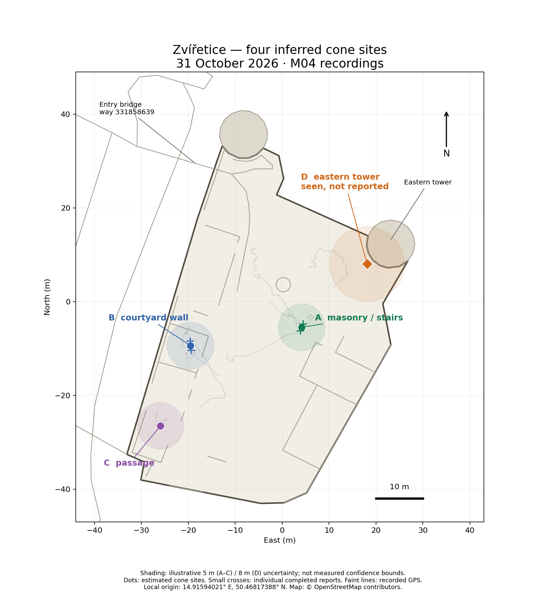
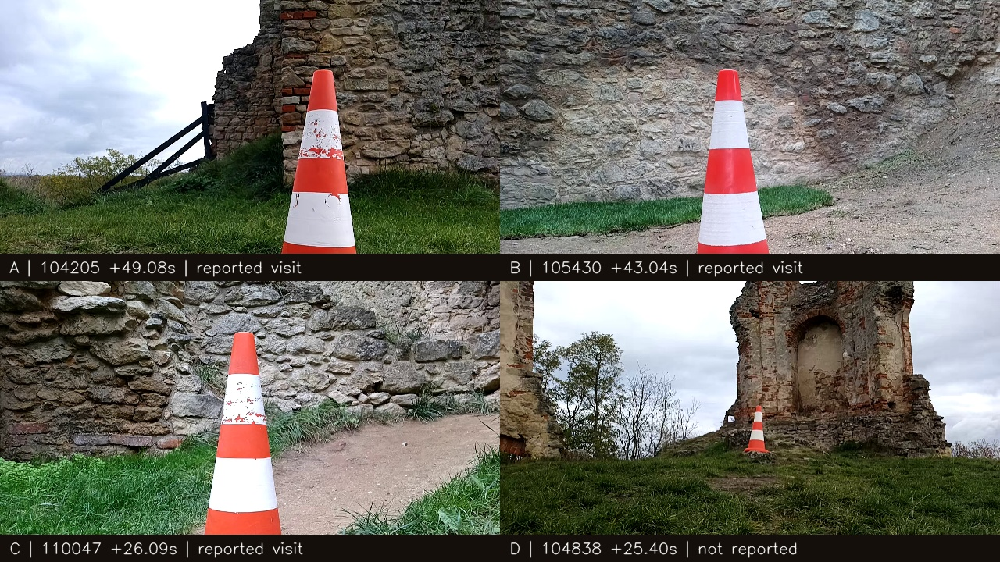

# Four cone sites — Zvířetice, 31 October 2026

Review of the 15 M04 DH2 recordings and the stored [OSM map](zviretice.osm.gz).
The evidence supports **four distinct cone sites: three reported, one seen but
not reached/reported**. Five application report events represent repeated visits
to three sites. These labels describe this review, not the game's defender IDs
or an official score. They assume the cones stayed in place during the runs.



| Site | Approximate location | Latitude, longitude (WGS84) | Evidence in `m04-dh2-261031_*.log` |
| --- | --- | --- | --- |
| A | Central/eastern ruins, beside masonry and wooden stairs | 50.46812, 14.91600 | Reports: `104205` +50.947 s and `110921` +97.758 s. Same scene from different approaches. |
| B | Western courtyard, wall with scaffolding nearby | 50.46809, 14.91566 | Reports: `105430` +44.774 s and `110504` +212.491 s. Matching wall/scaffolding context. |
| C | Southwestern passage/path beside masonry | 50.46794, 14.91557 | Report: `110047` +26.952 s. Also visible in `105716` around +127.5 s and `105954` around +13.8 s. |
| D | Below the eastern tower, on its southwest side | 50.46825, 14.91620 | Clearly visible in `104838`, e.g. +20 to +25.4 s. Approach stopped by depth at +25.417 s; no report. |

Coordinates are approximate review locations. In particular, D's final decimal
places should not be interpreted as surveyed precision. All four point estimates
are inside castle outline **way 24857326**. Entry bridge **way 331858639** is at
the northwest end of the map. D is near tower **way 183038665**; this association
is consistent with the RGB scene and the estimated position.



## The unreached cone

D is a real, visually identifiable cone, not merely a detector hypothesis. In
`104838` the controller approached it from +10.403 s until a depth obstacle stop
at +25.417 s. Recovery scanning/departures followed. The cone was still visible
around +53.8 s, but no `app.defender` was emitted during that run. The selected
centered detections put it roughly 5–7 m ahead during +18 to +25.4 s; that range
is an image-height approximation, not measured stereo range to the cone.

C also had unsuccessful attempts (`105716`, `105954`) before the successful
`110047` visit. Thus an unsuccessful recording alone does not identify which
physical cone was never reported; cross-run scene association is necessary.

The earlier `102806` run contains many tiny boxes on distant masonry and large
boxes on clothing/legs. Selected positives in `101546`, `102711` and `110227`
also include people or masonry. Those are not additional cone sites. The four
sites above each have positive RGB evidence; no fifth site is inferred from a
box count.

## How positions were estimated

No controller or replay outputs were changed, and no points were snapped to
walls or to the castle polygon.

1. Read `gps.nmea_data`, `platform.pose2d`, `platform.joint_angle`,
   `oak.detections`, `app.status` and `app.defender` from the event logs.
2. Convert longitude/latitude to a local east/north frame using spherical Earth
   radius 6,371,000 m and origin **14.91594021 E, 50.46817388 N**. This origin is
   the mean of the castle way's stored coordinates, including its closing node.
3. For each relevant run, interpolate local odometry at GPS host-log timestamps.
   Fit a rigid 2D rotation/translation, without scale change. Ten weighted
   Procrustes iterations use weights `min(1, 1.5 / residual_metres)`, initially 1.
   This estimates the run's local-to-geographic heading; it does not correct
   absolute GPS bias. Optional odometry scale diagnostics were not applied.
4. For each completed report, take the median robot GPS position within ±3 s
   (six fixes in each case). Add the rotated application offset
   `report.position - report.stop_pose`. Average the two event estimates for A
   and B; C has one report. This uses nearby GPS rather than a whole-run fitted
   translation to avoid propagating long-term drift into the anchor.
5. For D, use 74 detections during +18 to +25.4 s with confidence ≥0.9 and image
   center between 0.3 and 0.7. Interpolate robot GPS, odometry yaw and articulation
   at each host timestamp. Approximate range as `0.65 / bbox_height` metres and
   bearing as `odom_yaw + 0.5 * joint_angle + (0.5 - bbox_center) * 45 degrees`.
   Rotate into the geographic frame and take the median projected position.
   The range, articulation split and image FOV are assumptions, not calibration.

The runtime report's cone offset is itself an image-based estimate, not a
stereo measurement. Depth-color alignment was not used for ranging in this review.

## Accuracy and uncertainty

The two A event estimates differ by **1.55 m**; the B estimates differ by
**1.98 m**. This agrees with repeat visits to the same places. It measures
repeatability of this procedure, not absolute accuracy against OSM or ground
truth. Nearby fixes within each report's six-second window vary by less than
0.5 m from their median, but may share a common bias.

| Run | GPS/odometry rigid-fit median residual | 90th percentile residual |
| --- | ---: | ---: |
| `104205` (A) | 0.48 m | 1.15 m |
| `110921` (A) | 0.50 m | 1.10 m |
| `105430` (B) | 1.06 m | 3.71 m |
| `110504` (B) | 0.53 m | 1.23 m |
| `110047` (C) | 0.53 m | 0.80 m |
| `104838` (D) | 0.39 m | 1.20 m |

These are agreement residuals between two imperfect sensors, not GPS error
bounds. Absolute GPS bias, OSM geometry error, wheel slip, handling, heading
estimation and image-range error remain. C's short trajectory gives weaker
heading support; D has no close visit to anchor it. Low NMEA HDOP values do not
provide a measured absolute position accuracy for this review.

The map and GeoJSON show **illustrative 5 m radii for A–C and 8 m for D** so the
points are read as approximate areas. These are review allowances, **not measured
confidence regions or guaranteed bounds**; true systematic error can be larger.
The four-site interpretation is stronger than the exact coordinate estimates.

GPS sentence UTC and log-header UTC differ by roughly 169 s throughout the event.
This is consistent with a clock offset, but does not independently establish
sensor latency. Streams were associated by their common host-log timestamps;
no 169-second shift was applied to GPS samples.

## Files and checking the evidence

- [Map image](cones-2026-10-31.png).
- [GeoJSON layer](cones-2026-10-31.geojson): four estimated points and four
  illustrative uncertainty polygons; coordinates are longitude, latitude.
- [Evidence CSV](cones-2026-10-31-evidence.csv): five completed-report estimates
  and the 74 D projections. East/north columns use the local origin above;
  rows are observations of the same sites, not additional cones.
- [RGB evidence sheet](cones-2026-10-31-evidence.jpg).

Review the unreached approach using the viewer:

```bash
uv run --locked python -m dh2.viewer \
  /data/matty/m04-dh2-261031_104838.log --start 18 --pause
```

For the successful sites, start near A: `104205` +49 s, B: `105430` +43 s,
C: `110047` +26 s. Other report events and run summaries are in
[zviretice.md](zviretice.md). Only the 2026-10-31 event recordings were used.
