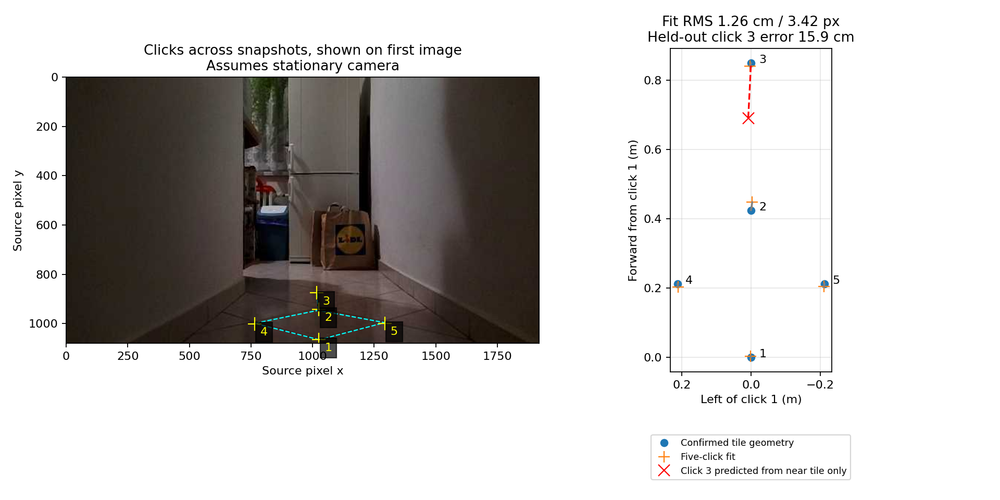

# M04 tile projection — 2026-11-12

The five saved clicks support an exploratory floor-relative homography, but do
not yet independently validate robot-relative target distances.

Inputs: `/data/matty/matty-clicks-2026-11-12T18-43-22-684Z.json` and its
source log `/data/matty/m04-camera-monitor-261112_184242.log`. All three annotated
snapshots were matched to the source log by header start time, RGB receipt time,
packet end offset, and exact decoded/transmitted JPEG bytes. Original logs and
annotations were not modified.

The operator confirmed square 30 cm tiles and these point identities: clicks
1–3 are consecutive centreline vertices; 4 and 5 are left/right vertices of
the square between 1 and 2. Assuming the camera stayed stationary across the
three snapshots, define click 1 as (forward, left) = (0, 0):

| Click | Source pixel (x, y) | Expected forward (m) | Expected left (m) | Fit error (cm) |
| --- | --- | ---: | ---: | ---: |
| 1 | (1026, 1064.75) | 0 | 0 | 0.35 |
| 2 | (1026, 941.75) | 0.424264 | 0 | 2.32 |
| 3 | (1017, 875.75) | 0.848528 | 0 | 0.97 |
| 4 | (765, 1001.75) | 0.212132 | +0.212132 | 0.90 |
| 5 | (1293, 998.75) | 0.212132 | -0.212132 | 0.84 |

The 42.4 cm spacing along the corridor is a square's diagonal, not its 30 cm
side. The fit minimizes pixel reprojection error and uses the raw image without
lens undistortion. Its five-point RMS residual is **1.26 cm / 3.42 source pixels**.
That is agreement with fitted points, not independently measured accuracy.

An independent check fits the near square using clicks 1, 2, 4 and 5, then
predicts excluded click 3. It predicts (0.6901, 0.0080) m instead of
(0.8485, 0) m: **15.9 cm error**. Four near corners exactly constrain a
homography, so small corner-selection errors can strongly affect extrapolation.
The limited point layout, lens distortion and manual selections have not been
separated as causes. Do not use this fit for robot motion or treat it as a
measured camera calibration.



`fit.json` contains the full matrices, provenance, per-point residuals and
independent check. It is an analysis artifact with a floor-relative coordinate
frame; it is not the JSON format accepted by the monitor's `--calibration`.
No monitor or motion-controller behavior was changed by this analysis.

## Marker and approximate physical camera model

The newer export `/data/matty/matty-clicks-2026-11-12T18-52-51-690Z.json`
retains the first five clicks and adds click 6 from
`m04-camera-monitor-261112_185220.log` at RGB receipt time +12.038244 s,
packet end offset 2214657. That frame's header/time/offset/JPEG also match the
source recording exactly. Its selected source pixel is (1023, 1061.75).
Background feature tracking between the first tile snapshot and the marker
snapshot found 174 consistent tracks with median displacement 0.24 preview
pixels (640×360); this supports, but does not prove, the stationary-camera
assumption across recordings.

The operator clarified these measurements:

- Marker: **1.00 m horizontally along the floor from the camera**, not a slant
  distance from lens to marker and not 1.00 m from the front axle.
- Camera height: approximately **29 cm**, pointing forward.
- Camera: **5 cm forward of the front-wheel axle**.

The marker is therefore expected 1.05 m ahead of the axle. The physical candidate
assumes a level camera, centred laterally and aligned with the corridor. It uses
RGB/CAM_A factory intrinsics/distortion from
`/data/matty/m04-dh2-oak-calibration.json`, device `14442C10116FDAD600`, with
3840×2160 intrinsics scaled by 0.5 to 1920×1080. Matching camera identity and
uncropped stream geometry remain assumptions; the recording does not independently
establish the device ID. Focus-dependent geometry and exact mounting pitch/roll
have not been measured here.

This model projects click 6 to **(1.05645, -0.01860) m from the axle**:
**1.00645 m forward from the camera**, 6.4 mm beyond the measured 1 m, and
1.86 cm right of the assumed centreline. Height and mounting are approximate;
this is one-point agreement, not millimetre-level calibration accuracy.

The model was not fitted to these clicks. Its tile-spacing checks remain mixed:

| Pair | Expected (m) | Physical candidate (m) |
| --- | ---: | ---: |
| 1–2 diagonal | 0.4243 | 0.3698 |
| 2–3 diagonal | 0.4243 | 0.3413 |
| 1–4 side | 0.3000 | 0.2508 |
| 4–2 side | 0.3000 | 0.2872 |
| 2–5 side | 0.3000 | 0.2789 |
| 5–1 side | 0.3000 | 0.2665 |

The marker can also anchor the empirical tile fit's translation: it maps to
(0.01153, 0.00294) m relative to click 1, so the tile origin becomes
(1.03847, -0.00294) m relative to the axle, assuming aligned forward axes and a
centreline marker. This is derived from the same fitted homography, not an
independent measurement of every tile corner. Against that anchored geometry,
the physical model differs by about 13 cm at click 3. Neither the near marker
nor the small five-point fit residual establishes reliable distant projection.

`marker-check.json` records inputs, provenance, assumptions, projections and
pair checks. `m04-ground-candidate.json` is accepted by the monitor's
`--calibration` option for **read-only preview**. Its origin is the front-axle
midpoint projected onto the floor; axes are forward/left/up. The 2.5 m range
limit is a preview bound, not a validated clearance or range guarantee. Do not
connect this approximate candidate to motion. Further useful checks are markers
at several distances (e.g. 1.5 and 2 m), lateral offsets and a more precise
mounting-height/pitch measurement, without moving the camera between samples.

## Reproduce

From the repository root:

```sh
.venv/bin/python click2go/fit_tile_projection.py \
  /data/matty/matty-clicks-2026-11-12T18-43-22-684Z.json \
  --output doc/click2go-corridor-2026-11-12
.venv/bin/python -m unittest discover -s click2go -p test_fit_tile_projection.py -v
```

Four focused tile-fit synthetic tests pass: known projective geometry, independent
far-corner error detection, unchanged inputs, and invalid/mixed/degenerate
correspondence rejection. No new hardware or motion test was run.

Reproduce the separate physical marker check:

```sh
.venv/bin/python click2go/check_marker.py \
  /data/matty/matty-clicks-2026-11-12T18-52-51-690Z.json \
  --factory-calibration /data/matty/m04-dh2-oak-calibration.json \
  --horizontal-distance 1.0 --height 0.29 --camera-forward 0.05 \
  --output doc/click2go-corridor-2026-11-12
.venv/bin/python -m unittest discover -s click2go -p test_check_marker.py -v
```

Three additional synthetic marker tests pass: known marker/axle geometry,
full-resolution intrinsics resizing, and rejection of invalid measurements,
source aspect ratios and click indices. Source logs and exports remain unchanged.
