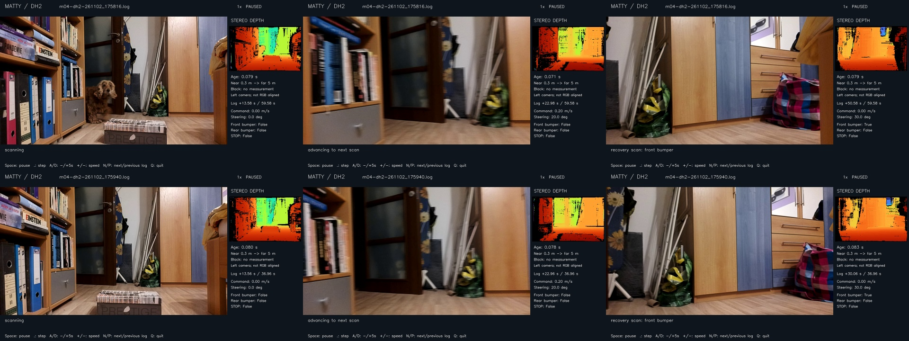
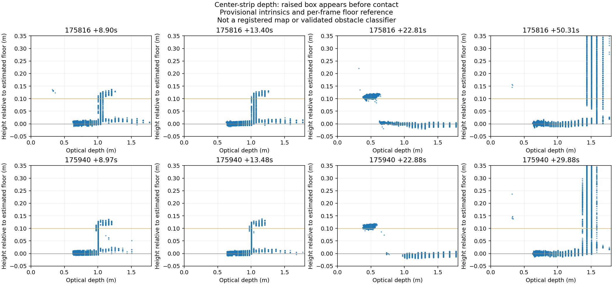

# M04 indoor low-box obstacle trials — 2 November 2026

Two recordings using the approximately 10 cm box from the tilt experiments as an
obstacle. This is observation of the existing controller, not a new avoidance
implementation. Both normal `app` replays match. Both strict IMU capture checks
pass; raw accel/gyro and fused orientation are present at approximately 100 Hz.

## Contacts and controller response

| Recording (`m04-dh2-261102_*.log`) | Application end | Front activations | First contact | Initial depth stop | Recovery departure before contact |
| --- | ---: | ---: | ---: | ---: | ---: |
| `175816` | 59.676 s | 3 | 50.431 s | 23.108 s | 48.814 s |
| `175940` | 36.974 s | 4 | 29.941 s | 23.382 s | 28.623 s |

There are **no rear-bumper activations**. STOP is pressed at the end of each run.
The existing mission was enabled here: exploration commands reach 0.2 m/s;
embedded `max_speed` is 0.3 m/s and reverse is permitted. This differs from the
zero-propulsion tilt tests, as expected for an obstacle approach.

Each first contact occurs while the latest application command is
`[200, -3000]` (0.2 m/s, −30°). The next application command is `[0, 3000]`,
about **0.5 ms later** in logged application time: propulsion stops and a recovery
scan is requested. This is command/log timing, not physical braking latency.
No further positive-propulsion command occurs after that first contact in either
recording. The additional bumper activations therefore must not be described as
additional commanded forward approaches.

| Run | Front activation times | Latest command before activation |
| --- | --- | --- |
| `175816` | 50.431, 53.348, 56.458 s | +0.2 m/s at −30°; then 0 at −30°; then 0 at 0° |
| `175940` | 29.941, 31.273, 33.964, 35.465 s | +0.2 m/s at −30°; then 0 at +30°, −30°, +30° |

Measured joint angles also change during these intervals. The later transitions
are consistent with contact/recontact or changing bumper load during look-around;
the logs do not identify every physical cause or operator interaction. **Zero
propulsion does not imply zero body sweep on this platform.**

The first run spends about 25.7 s between the initial depth stop and the eventual
recovery departure; the second waits about 5.2 s. This reinforces why remembered
nearby obstacles should not simply expire during a long stationary recovery.

## Depth before and at contact

Rows are `175816` and `175940`; columns are approximately +13.5 s, +22.9 s and
just after first contact. RGB and stereo depth are displayed separately. The box
is visible early, but it is below the useful forward view near contact.

The existing depth ROI does stop an advance at about +23 s in both runs. That
alone does not identify which surface caused the stop: surrounding furniture is
also visible. At first contact the recorded ROI is **not blocked**, with clearance
about **1.367 m** and **1.432 m**, respectively. Those values clearly do not
represent bumper clearance to a low obstacle.

The early depth profiles contain a raised surface/vertical transition consistent
with the box, roughly **0.10–0.13 m above the local floor**. It is around **1 m
optical depth** at +9/+13 s and around **0.5 m** at +22.8 s. By the sampled frame
just before contact, that near raised patch is no longer in the central sampled
view, although farther floor/furniture returns remain. This is useful positive
evidence for the proposed obstacle-memory regression case.

This is a diagnostic profile, not a calibrated reconstructed map or obstacle
classifier. It uses the captured resized-left K (not yet verified as the exact
rectified-depth K), the tested raw/fused frame rotation, factory camera/IMU and
rectification rotations, and an approximately synchronized camera attitude.
Sample every second depth pixel, accept optical depth 0.15–2 m, and inspect a
center strip with optical lateral coordinate within ±0.2 m. Normalize heights
by a per-frame floor estimate (median of the 10th–30th height-percentile band).
The profile's arbitrary initial camera-height offset cancels in that normalization.
No cross-frame camera translation or registration is claimed.

The raised patch can be measured **before the first exploration advance** around
+13.6 s. Therefore an appropriate low-obstacle classifier has earlier evidence
to retain; these are not solely bumper-only detections. A mapper still needs to
show that its projected cells remain in the correct body sweep after translation
and articulation. This review does not demonstrate that an implemented map would
already have prevented contact.

## Required refinement to the map MVP

The [proposal](dh2-local-map-mvp.md) now explicitly covers both motions:

1. Retain confirmed low-obstacle cells after their face/top moves below the image.
   An empty current ROI must not remove them or declare a previously blocked
   body path clear.
2. Check **zero-propulsion articulation sweeps**, not only translating paths.
   Immediately after contact, the existing controller requests a large change
   from approximately −30° articulation to +30°. That moves both body sections
   and their bumpers even at desired speed zero.
3. On an ordinary map veto, hold the measured articulation instead of automatically
   recentering to zero, which is another physical movement. Keep physical emergency
   stop behavior and the existing bounded-retreat/rear-bumper policy. Verify the
   hold action on hardware; it is a proposed change, not implemented here.
4. Record initial depth recognition, its later remembered cells, and the proposed
   translating/articulation sweeps in shadow mode. These short indoor runs should
   become the first regression inputs before the longer outdoor `101546` case.

No runtime or configuration changes were made in this review. The next step is
still a front-frame pose provider and shadow map, followed by physically validated
motion inhibition rather than additional blind contact trials.

[Machine-readable timeline and capture checks](dh2-box-261102.json) ·
[Raw IMU frame analysis](dh2-indoor-261102-raw.md)
