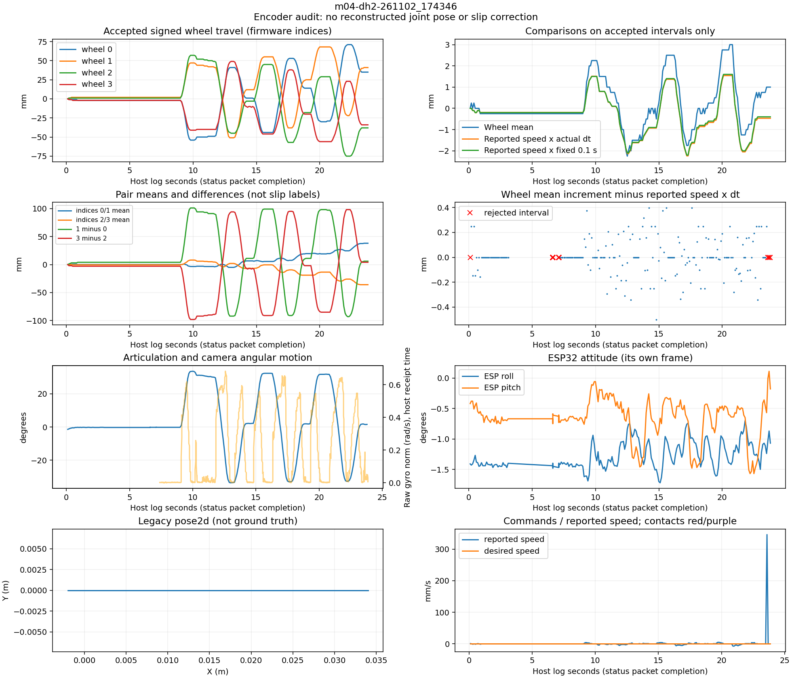
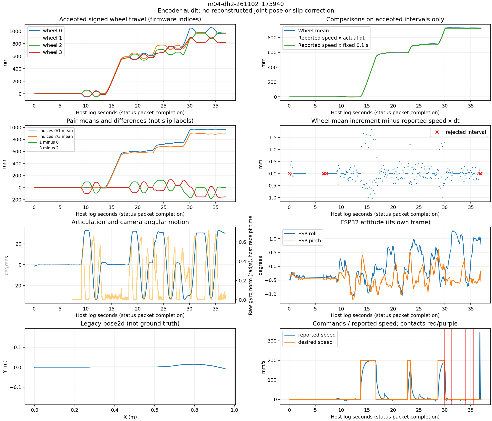

# Stage 2A — first encoder audit, 3 November 2026

Implemented `python -m dh2.encoder_audit` as an **offline inspection tool**. It
extracts status packets from existing recordings, unwraps per-wheel millimetre
increments over plausible intervals, and compares their mean with reported speed.
It does not produce a new pose, label wheel disagreement as slip, or change driving.

## Run it

From the repository root:

```bash
uv run --locked python -m dh2.encoder_audit \
  /data/matty/m04-dh2-261102_174346.log \
  /data/matty/m04-dh2-261102_175940.log \
  --output /tmp/dh2-encoder-audit
```

Each input gets a subdirectory named after its stem, containing `report.json`,
`status.jsonl` (all checksum-valid status payloads, including flagged sensor errors),
`intervals.csv` (including rejected
intervals and reasons) and `audit.png`. Bounds are configurable with `--max-gap`
(default 0.5 s) and `--max-wheel-speed` (default 1.5 m/s per wheel). They are
plausibility settings, not claimed robot motion/terrain limits; accepted travel
must stay below half the counter modulus for unambiguous signed differences.

## Incoming packets and timing

A correction to the earlier plan: **`serial.raw` is the incoming status stream**
in the DH2 configuration. `platform.esp_data` records outgoing commands. The tool
derives the input from the configured link into `platform.esp_data`; `--stream`
can override that choice for another recording. Outgoing packets are inspected
separately for explicit reset commands.

The temporary offline adapter reuses OSGAR's Matty escaping/checksum/constants,
with incremental length-based framing to handle fragments, batches and the final
complete packet at EOF. It never starts the Matty node or invokes motor handlers.
Status timestamps are the receipt time of the message containing the final packet
byte, rather than waiting for a subsequent SYNC byte as the legacy driver does.
These are **host receipt times, not firmware acquisition times**.

Firmware information counters also advance on GPS/version messages. Status-to-
status counter jumps are therefore not themselves lost packets. Across the seven
reviewed logs, checking the shared I/P/V sequence finds no missing information
counter steps. Acknowledgements use command counters and are excluded from that
sequence check. Counter wraps, repeats and ambiguous restarts are handled separately.

The startup capture contains delayed batches of roughly 35–37 status intervals
sharing host timestamps and gaps around camera startup. The tool preserves them
but excludes intervals with missing/ambiguous timing from speed integration. It
does not invent evenly spaced sample times. Rejected intervals make the resulting
cumulative curves incomplete comparisons, not continuous ground-truth distances.

## Results on existing logs

All values below use **only the same accepted intervals** in each row. Wheel
mean is signed rolling travel, not measured joint-centre displacement. File date
is 2026-11-02 except outdoor `101546`, which is 2026-10-31.

| Run | Status packets | Accepted intervals | Mean wheel increments | Reported speed × actual dt | Reported speed × fixed 0.1 s | Encoder-error samples |
| --- | ---: | ---: | ---: | ---: | ---: | ---: |
| `174346` flat scan | 238 | 196 | +1.00 mm | −0.47 mm | −0.40 mm | 3 |
| `174419` front right | 274 | 233 | +4.00 mm | +4.33 mm | +4.30 mm | 3 |
| `174456` both front | 286 | 244 | +1.75 mm | +1.17 mm | +1.20 mm | 3 |
| `174534` rear right | 274 | 231 | −1.75 mm | −0.30 mm | −0.30 mm | 3 |
| `175816` first box | 596 | 555 | 939.25 mm | 933.17 mm | 933.10 mm | 2 |
| `175940` second box | 370 | 328 | 929.75 mm | 924.81 mm | 924.50 mm | 3 |
| `101546` outdoor | 4,038 | 3,983 | 20,579.00 mm | 20,478.70 mm | 20,475.60 mm | 9 |

The close agreement supports the firmware interpretation: transmitted values
are cumulative millimetres and reported speed reflects the wheel average. It
does not validate the configured wheel diameter against physical travel or prove
absence of slip. Do not multiply these values by servo distance-per-tick again.

On accepted intervals, actual-dt and fixed-0.1-s speed integrals are very close
in these data. Merely replacing the fixed period is not the main correction
suggested by this audit. Timing uncertainty, bad readings and kinematics still
matter; receive time is not automatically the sensor's integration interval.

The flat scan's wheel mean is near zero although individual wheel paths reach
about ±75 mm, as expected during articulation. Pair 0/1 and pair 2/3 means also
drift oppositely by several centimetres over repeated scans. Such differences
need the articulated model and independent scene geometry before being called
body travel or slip.



## Real read errors must be exposed to the pose provider

All four raw-enabled posture recordings end with three status samples carrying
encoder/power error flags. Their reported speeds include a spurious 289–346 mm/s
sample despite zero desired propulsion. Legacy planar pose ends about **29–37 mm**
from its initial X coordinate. That is not evidence of actual forward motion;
accepted wheel means remain within 4 mm of zero.

The box run `175816` also has an encoder-error sample at **+35.707 s** with reported
speed **−511 mm/s**, during recovery scanning, plus a final faulty sample. The
outdoor run has nine flagged samples, including six before the terminal fault
sequence. These are not just a hypothetical failure mode of the new encoder API.



The available firmware source sets an encoder error after a failed servo read but
still calls its encoder/odometry update. That deserves a separate firmware review:
invalid/partial servo results can contaminate counts and speed. The logs do not
prove the precise lower-level failure or that the available source is the exact
flashed revision. Their version replies identify M04, protocol/firmware version 8.

The audit rejects flagged intervals, the first interval after a flagged reading,
implausible wheel jumps, explicit reset crossings and ambiguous timing/counter
intervals. The following clean reading becomes the new baseline; it does not
bridge a bad interval into apparent travel. Subtle resets or plausible corrupted
increments can remain undetected, so validity checks are not proof of correctness.

**Runtime consequence:** four encoder integers alone are insufficient for quality-
aware integration. Expose status/encoder-validity information alongside them in a
small platform-driver change before connecting the pose provider. Keep raw values
available for diagnosis rather than quietly repairing them. A long-lived mapping
node should not duplicate the ESP packet parser just to recover status flags.

## Wheel ordering and next implementation decision

The source identifies even indices as the left side. Flat-scan data show opposite
pairwise turning differences for 0/1 versus 2/3, consistent with front/rear motion
seen by the IMUs. The likely order is front-left, front-right, rear-left, rear-right,
but physical servo-ID confirmation remains outstanding. Plots/exports therefore
use firmware indices instead of silently committing to physical labels.

Proceed with a joint-centred articulated model using per-wheel increments and
verified front/rear attitude, with explicit quality flags. The data support that
starting point; they do not justify calling the raw four-wheel mean an accurate
joint translation or claiming that four encoders solve common-mode wheel slip.
Keep the legacy pose for comparison and validate against a fixed scene/measured
displacement before using new poses to veto motion.

## Verification

- Ten focused tests cover packet splitting/batching, escaping, checksum rejection,
  EOF completion, units/wrap, forward/reverse and steering cancellation, irregular
  intervals, reset timing, error recovery and input-stream selection.
- All **58 DH2 tests** and lint pass.
- All 370 extracted encoder lists in `175940` match an independent forced replay
  of the OSGAR `feature/matty-encoders` driver exactly.
- Existing controller replay baselines for these recordings were already verified;
  this offline tool changes no configured node outputs or physical trajectory.

[Machine-readable summaries](dh2-encoder-audit.json) ·
[Stage 2 plan](dh2-stage2-plan.md)
