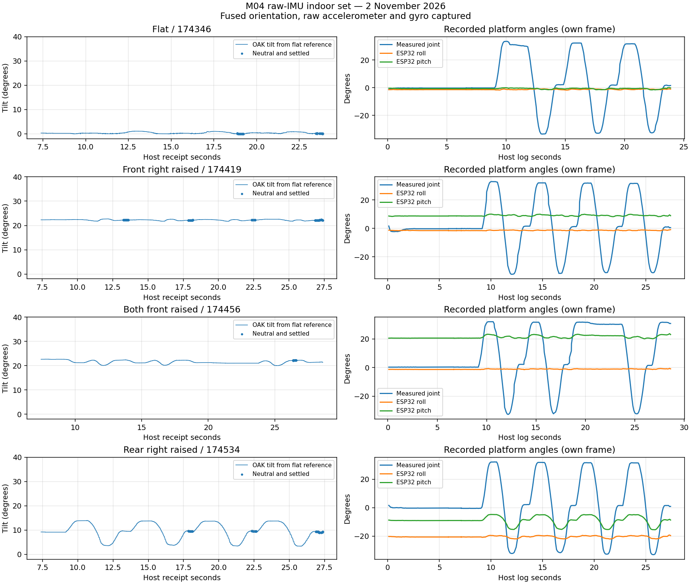
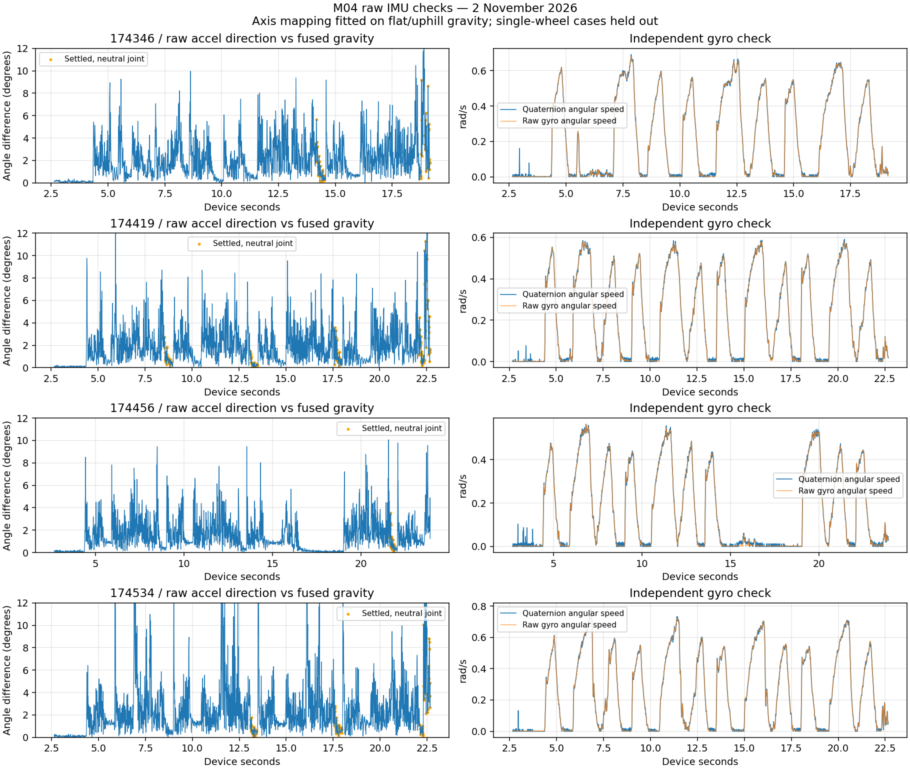

# M04 indoor review — raw IMU capture verified

Third set, 2 November 2026. Operator-specified order: flat, front right wheel on
the box, both front wheels on the box, rear right wheel on the box. This follows
the [first](dh2-indoor-261102.md) and [second](dh2-indoor-261102-second.md) sets.

**All four recordings contain integrated orientation, raw accelerometer and raw
gyro. The driver/launch update is now verified by actual recorded data.**
All four strict sensor checks pass. All four `app` replays match, and every recorded
propulsion command is zero. No changes to robot behavior were made for this review.

## Recording quality

| Recording (`m04-dh2-261102_*.log`) | Posture | Samples in each IMU stream | Fused / accel / gyro mean Hz |
| --- | --- | ---: | --- |
| `174346` | Flat | 1,655 | 100.07 / 100.08 / 100.07 |
| `174419` | Front right raised | 2,005 | 100.06 / 100.10 / 100.06 |
| `174456` | Both front raised | 2,125 | 100.06 / 100.09 / 100.06 |
| `174534` | Rear right raised | 2,005 | 100.06 / 100.08 / 100.06 |

No malformed samples, nonincreasing device timestamps or gaps over 100 ms occur.
Largest fused/gyro gaps are about 10.7 ms. Raw accelerometer periods are not uniform:
median about 8.2 ms and maximum about 16.4 ms, despite the approximately 100 Hz
average. **Use individual timestamps rather than assuming fixed 10 ms intervals.**
All streams arrive in five-sample batches; sample acquisition times differ between
sensors and should not be equated by batch index.

Quaternion norm error remains below 0.000046. Host-minus-device variation is about
65–73 ms across samples/batches; this is not an absolute latency measurement.

## Postures and articulation repeat



| Posture | Camera tilt relative to flat | Diagnostic fore/aft / transverse components | ESP32 roll / pitch |
| --- | ---: | --- | --- |
| Flat | Reference | ~0° / ~0° | −1.13° / −0.53° |
| Front right raised | 22.19° | +9.71° / −20.32° | −1.34° / +8.85° |
| Both front raised | 22.16° | +22.16° / ~0° | −1.09° / +20.47° |
| Rear right raised | 9.50° | −9.42° / +1.24° | −20.11° / −8.61° |

The front/rear distinction repeats: front-right support rolls the camera section
substantially while ESP32 roll stays near zero; rear-right support rolls ESP32
substantially while camera transverse tilt stays small. This supports separate
front/rear attitude handling on Matty's articulated chassis.

The table uses the same diagnostic construction as the second set: after host
+9.5 s, measured joint within ±2° and joint rate below 3°/s. Selected quaternion
counts are 75, 170, 30 and 125. Flat gravity defines up; the both-front gravity
change defines forward, and left completes a right-handed basis. Components
are `atan2(g_forward, g_up)` and `atan2(g_left, g_up)`, with nose-up positive.
These are diagnostic plane tilts, not calibrated OSGAR Euler angles. The small
both-front selection is a limitation; the larger first/second-set results provide
additional support for its interpretation.

The flat-run camera heading/joint slope is +0.502, and ESP32 counterclockwise
heading/joint slope −0.503, repeating the half-joint yaw relation. Translation,
lever arms and the precise odometry reference origin are still not established.

## Raw sensor frame versus fused quaternion frame

The raw accelerometer points approximately along +Y on level ground. The same
physical up direction expressed using the fused quaternion is approximately −X.
Thus raw vectors and quaternion coordinates cannot be combined directly.

The following proper rotation maps the recorded raw accel/gyro coordinates `R`
into the coordinate frame `F` used by the fused quaternion:

```text
v_F = C_FR * v_R

C_FR = [ 0  -1   0 ]
       [-1   0   0 ]
       [ 0   0  -1 ]
```

This is a fixed axis permutation/sign change, not an empirically changing tilt
correction. It is an observation validated on this M04/software combination;
do not silently apply it to every OAK model/firmware without a convention check.

### Acceleration-direction check

Compute fused up as `rotate(conjugate(q), [0,0,1])`, with normalized quaternions.
Normalize each raw acceleration vector; map it by `C_FR` and compare directions
at matching **device** times. Gravity directions between quaternion samples are
linearly interpolated and renormalized for this diagnostic.

Choose the best of the 24 proper signed-axis permutations using only the flat
and both-front settled selections. The selected mapping has median training
error about 1.23°; the runner-up is about 4.34°. The two single-wheel cases are
held out from that choice and provide a separate check:

| Run | Settled median raw/fused direction difference | 90th percentile |
| --- | ---: | ---: |
| Flat | 1.51° | 5.19° |
| Front right | 0.83° | 4.56° |
| Both front | 0.62° | 2.47° |
| Rear right | 0.82° | 6.30° |

These differences include raw sensor calibration, vibration/acceleration and
settling errors. A neutral joint/rate test is not proof of zero acceleration.
Do not treat instantaneous raw acceleration as a noise-free gravity vector.

### Independent gyro check

Normalize consecutive quaternions and use the shortest-sign relative rotation
`conjugate(q_i) * q_(i+1)` to calculate body-frame angular velocity divided by
actual device-time separation. Interpolate raw gyro onto the quaternion interval
midpoints, map it by the same `C_FR`, and compare the full XYZ vectors.

On dynamic portions (mapped gyro norm >0.1 rad/s, excluding the first two seconds
of quaternion data), per-component RMS differences are **0.0059, 0.0058, 0.0070,
0.0101 rad/s** in recording order. Through-origin vector gains are **0.9993,
0.9992, 0.9992, 0.9931**. This independent agreement supports the axis mapping and
the raw-gyro/fused time relationship; it is not an absolute attitude ground truth.



The gyro panel displays angular-speed magnitudes for readability; the reported
RMS/gain checks use all three components, so a magnitude-only agreement was not
used to validate axes.

## Acceleration scale and camera geometry

Raw accelerometer units are m/s² and gyro units rad/s according to the installed
DepthAI API. Settled neutral acceleration-norm medians are about **9.17, 9.27,
9.24 and 9.11 m/s²**. Quiet pre-scan segments show similarly low magnitudes; this
is not solely a consequence of steering transients. The readings are below the
approximately 9.81 m/s² expected at rest. Bias/scale calibration needs investigation;
these four supported postures do not justify a complete calibration fit or an
invented correction factor.

For the MVP, prefer integrated orientation for tilt. Record raw data to diagnose
it and develop the estimator. Do not double-integrate this acceleration into an
assumed accurate position/Z estimate.

The new frame observation also explains the earlier factory-transform mismatch:
EEPROM raw-IMU-to-camera extrinsics cannot be applied to fused quaternion axes
without first accounting for `C_FR`. The candidate transform chain is:

```text
R_WF  = fused quaternion rotation (F -> its world frame W)
R_LR  = factory raw-IMU -> physical left-camera rotation
R_DL  = physical left -> rectified-left rotation

R_WD = R_WF * C_FR * transpose(R_LR) * transpose(R_DL)
```

Translations must follow the same declared frames and metre units; a quaternion
alone does not provide camera position. Rectified camera axes remain optical
(right/down/forward) until explicitly converted to body forward/left/up.

Applying this candidate chain plus that optical/body conversion gives a level-run
camera tilt of about 1.84° rather than the earlier near-90° contradiction. This
is a consistency check, **not a measured front-chassis mounting calibration**.
Use the captured factory file for device `14442C10116FDAD600`; do not replace the
camera-to-front-section mechanical transform with identity by assumption.

## Next step

These recordings are sufficient to start a front-frame pose3d provider in
shadow mode: integrated camera attitude with explicit frame conversion, wheel
odometry/articulation for translation, and documented remaining origin/lever-arm
assumptions. Keep raw data for diagnostics, and separate pose estimation from
periodic local-map publication and the driving veto.

The raw-capture failure is resolved; repeating all four postures solely to obtain
raw data is unnecessary. Fixed-scene and measured-displacement tests remain the
next geometry validation, not a reason to discard these recordings.

[Machine-readable analysis](dh2-indoor-261102-raw.json) includes capture statistics,
posture selection, the empirical basis, frame mapping and raw/fused comparisons.
