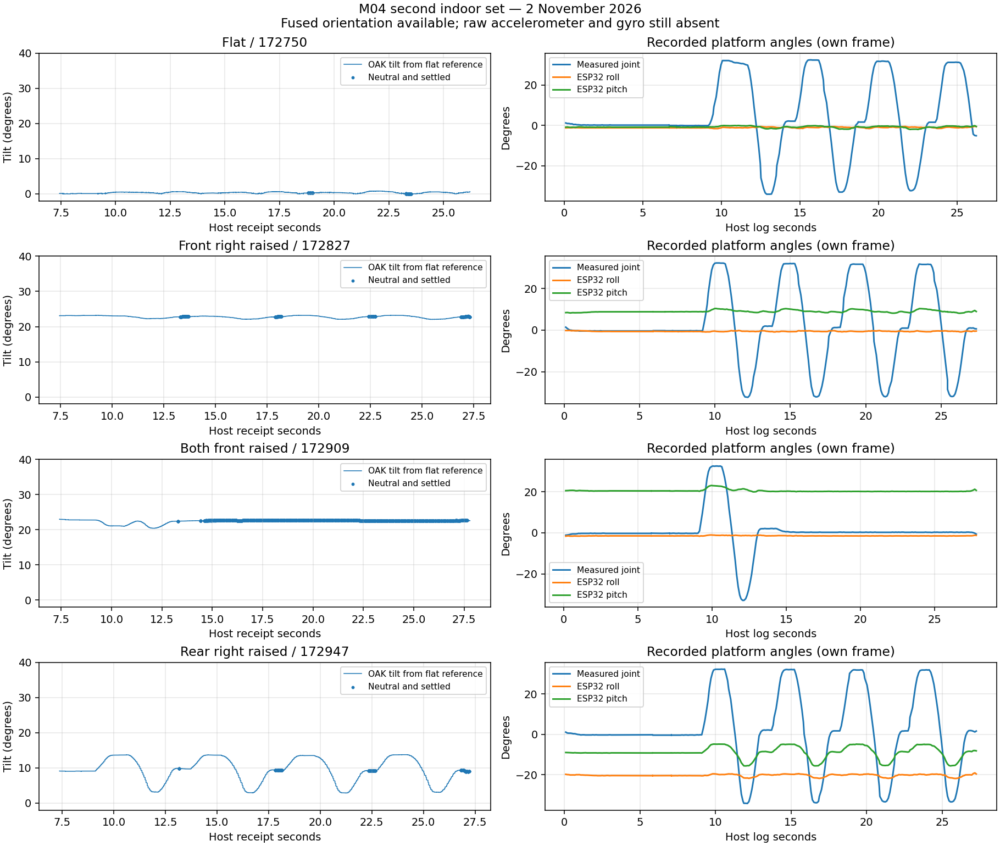

# M04 indoor review, second set — 2 November 2026

Four new runs, in the operator's stated order: flat, front right wheel on the box,
both front wheels on the box, rear right wheel on the box. These are separate
recordings from the [first indoor set](dh2-indoor-261102.md).

The subsequent [raw-enabled four-run set](dh2-indoor-261102-raw.md) verifies the
driver correction and compares raw acceleration/gyro with fused orientation.

**All four controller replays match. All recorded propulsion commands are zero.**
Fused orientation and color/depth are present, but **raw accelerometer and gyro
are still absent**: neither raw stream is registered despite `imu_raw_data=True`
in every embedded camera config. The previously reported branch correction has
not resolved raw capture in these files. This remains a software/launch-path
investigation; it is not evidence of a failed IMU or unusable tilt experiments.

## Capture quality

| Recording (`m04-dh2-261102_*.log`) | Posture | Fused samples | Rate | Maximum gap |
| --- | --- | ---: | ---: | ---: |
| `172750` | Flat | 1,885 | 100.07 Hz | 10.58 ms |
| `172827` | Front right raised | 1,995 | 100.07 Hz | 10.64 ms |
| `172909` | Both front raised | 2,045 | 100.07 Hz | 10.64 ms |
| `172947` | Rear right raised | 1,995 | 100.06 Hz | 10.59 ms |

There are no malformed fused samples, nonincreasing device timestamps or device
sample gaps over 100 ms. Maximum quaternion norm error is below 0.000044. The
strict full-IMU capture check fails because raw streams are missing, independently
of the successful controller replay and useful fused orientation.

## Front-camera and ESP32 response

| Posture | Camera total tilt from flat | Camera fore/aft component | Camera transverse component | ESP32 roll / pitch |
| --- | ---: | ---: | ---: | ---: |
| Flat | Reference | ~0° | ~0° | −1.04° / −0.86° |
| Front right raised | 22.81° | +10.61° | −20.64° | −0.61° / +8.76° |
| Both front raised | 22.61° | +22.62° | ~0° | −1.49° / +20.16° |
| Rear right raised | 9.29° | −9.28° | +0.53° | −20.07° / −8.65° |

The rear-right test supplies the useful complementary result: **ESP32 sees about
20° roll while the camera/front sees almost none**, and the camera instead tilts
fore/aft in the opposite direction to the front-wheels-raised case. Conversely,
front-right raising produces about 20° camera transverse tilt with almost no
ESP32 roll. This is strong evidence for treating the two attitudes separately
on the articulated platform, consistent with ESP32 following the rear section.
It is not a substitute for confirming the physical ESP32 IMU mounting.

During rear-right look-around the camera's total tilt varies substantially
(roughly 3–14° in the plot), while ESP32 roll remains around −20°. Thus even
the tilt of the front camera changes with articulation in this supported posture;
a single fixed tilt correction for the entire run would not suffice.

The front-right and both-front results repeat the first set reasonably closely:
total tilt differs by about 0.40° and 0.26°, respectively. The two sets are not
precision fixture measurements, so these differences are not calibration errors.

### Method and limits

Use the same settled selection as the first review: host time ≥9.5 s,
measured joint within ±2°, and estimated joint rate below 3°/s. Selected fused
sample counts are 55, 165, 1,320 and 125. Compute normalized median gravity
vectors from the quaternions, assuming their world Z is vertical. The flat-run
vector defines the reference up direction; total tilt is the angle to that vector.

For the diagnostic components, the both-front-raised vector defines the fore/aft
direction after projection perpendicular to flat up. Complete an orthonormal
basis with `left = up × forward`. Components are `atan2(g_forward, g_up)` and
`atan2(g_left, g_up)`, in degrees. Positive fore/aft here means nose-up; these
are plane-tilt diagnostics, **not OSGAR Euler pitch/roll or a calibrated pose3d**.
The flat and both-front cases define this basis, so their component values are
not independent validation. The two single-wheel cases test it independently.

The comparisons use approximate host receipt times only to select settled
segments. No depth/IMU clock synchronization, metric camera translation or Z
position has been established. The missing raw data prevents checking gyro and
accelerometer against the fused result.

## Heading and articulation

The flat run again gives approximately **+0.502 camera heading/joint degree**
and **−0.499 ESP32 counterclockwise heading/joint degree**. The camera-heading
axis was inferred from the empirical tilt basis above; absolute heading is not
calibrated. The raised cases give camera slopes +0.489, +0.475 and +0.516.

This repeats support for the approximate half-joint front/rear yaw model on level
ground. Inclined cases require full 3D rotations and do not justify treating roll,
pitch and joint yaw as interchangeable Euler-angle additions. Camera translation
and the odometry reference point remain unresolved.

## Resolve raw capture before repeating the whole experiment

Run the interpreter/source diagnostic from the [first review](dh2-indoor-261102.md)
in the **same shell that launches recording**. Its `publish_imu` method should
also be present in the supporting v3 driver. In particular, the loop script uses
plain `python`; updating a Git checkout does not necessarily update the package
imported by that interpreter.

Once the launch environment is corrected, a short flat recording is enough to
verify raw streams are registered and populated. Allow time for camera startup
(e.g. a 15-second recording); check it with `--require-oak-imu` before repeating
all wheel positions. No new posture experiment is required to retain the fused
orientation conclusions above.

[Machine-readable results](dh2-indoor-261102-second.json) include capture statistics,
selection counts, empirical gravity basis, yaw slopes and replay/command checks.
No runtime/configuration changes were made for this review.
