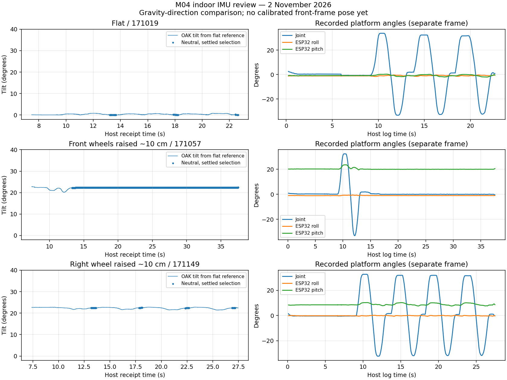

# M04 indoor review — 2 November 2026

Three recordings with `max_speed=0` and `allow_reverse=False`, in the operator's
stated order: flat floor, front wheels on an approximately 10 cm box, then right
wheel raised with the left on the floor. The operator confirmed the camera lid
was in its normal closed position once STOP was released. Ethernet was used to
start the runs; a STOP-held stationary baseline was not possible with this setup.

**These recordings are useful; they do not need repeating just to hold STOP.**
All three `app` modules replay normally with their embedded configurations.
Every recorded desired propulsion speed is zero, and each run ends with STOP.
Measured articulation changes, as expected for stationary look-around.

## Capture and tilt

| Recording (`m04-dh2-261102_*.log`) | Color/depth frames | OAK quaternion samples | OAK rate | Maximum sample gap | Neutral tilt relative to flat |
| --- | ---: | ---: | ---: | ---: | ---: |
| `171019` — flat | 153 / 153 | 1,520 | 100.09 Hz | 10.60 ms | reference |
| `171057` — front wheels raised | 303 / 303 | 3,020 | 100.08 Hz | 10.62 ms | 22.35° |
| `171149` — right wheel raised | 202 / 202 | 2,015 | 100.07 Hz | 10.64 ms | 22.41° |

There are no malformed quaternion samples, device-time resets or gaps over 100 ms.
Maximum quaternion norm error is below 0.000047. These are recording-quality
checks, not claims of measured attitude accuracy.



Tilt is computed from the reported quaternion's gravity direction, relative to
the flat run, rather than directly comparing roll/yaw Euler values. The raw OAK
Euler decomposition is near a pitch singularity in the flat run and is misleading
as a representation of robot attitude. No factory camera-to-body axis transform
has been asserted by this calculation.

For the table, select samples after host +9.5 s with measured articulation within
±2° and estimated articulation rate below 3°/s. Use the normalized median gravity
vector for each selection. Samples per selection: 105 flat, 2,425 uphill, 160
sideways. This avoids startup and most articulation transients. Approximate host
receipt time is sufficient for these settled comparisons, not a validated clock
alignment for moving depth projection.

Gravity-vector 10–90 percentile spread relative to the flat reference is roughly
0.03–0.15° in the flat selection, 22.32–22.36° uphill, and 22.36–22.49° sideways.
This indicates good short-term stability, not absolute angle calibration. The box
height alone does not define an exact expected angle without contact geometry.

## Camera versus ESP32 attitude

ESP32 median roll/pitch near neutral articulation is approximately:

- Flat: −0.81° / −0.95°.
- Uphill: −1.01° / +20.04°.
- Sideways: −0.09° / +8.46°.

The camera clearly senses a large sideways tilt in the third run while ESP32 roll
remains near zero. An empirical diagnostic basis, defined by flat gravity and the
uphill tilt direction, decomposes the sideways result into about 9.8° fore/aft
and −20.5° transverse tilt. These components are **not independently calibrated**:
the flat and uphill recordings were used to construct that basis. The independent
right-wheel case is consistent with substantial front-section roll.

Do not use ESP32 attitude as though it were the camera's rigid-body attitude.
Possible causes include the different articulated sections and coordinate
conventions. The IMU mounting locations and SDK fusion-frame convention still
need explicit verification; this review does not identify them conclusively.

The factory calibration file provides camera/IMU transforms, but its IMU frame
must not be assumed identical to the frame used by fused rotation-vector output.
The observed flat quaternion and the EEPROM transform do not yet provide a
validated front-body orientation transform. Use the tilt experiments to test the
complete convention, not just multiply matrices and assume it is correct.

## Articulation and pose origin

A diagnostic heading fit on the flat run gives about **+0.502° of OAK/front
heading per degree of measured articulation**, and **−0.502° of ESP32 heading**
(using counterclockwise yaw) per articulation degree. Fit residual standard
deviations are about 0.40° and 0.68°, respectively. The OAK forward axis for this
diagnostic was inferred from the flat/uphill gravity experiments; no absolute
heading calibration is implied. Raised cases give OAK slopes about +0.477/+0.485.

This supports the approximate half-joint front/rear yaw split for stationary
look-around. It does not establish the translation of the odometry origin,
camera lever arms, or full three-dimensional articulation. Camera motion during
look-around must still be modeled.

Recorded planar X spans 81, 69 and 65 mm in these three zero-propulsion runs.
Those values must not automatically be interpreted as robot forward travel:
articulation, wheel motion/slip and the current planar odometry model can contribute.
A pose provider should be checked against a fixed scene and mechanical reference,
not merely declared correct because the desired speed is zero.

## Missing raw IMU streams — driver branch identified

**Neither `oak.acc_raw_list` nor `oak.gyro_raw_list` is registered in any log.**
All three embedded configs nevertheless contain `imu_raw_data=True`,
`imu_orientation=True`, `is_imu_enabled=True`, batch size 5. Consequently
`dh2.sensor_check --require-oak-imu` correctly fails its full-capture check.
Integrated orientation remains useful; these are not empty or unusable runs.

The driver used on M04 likely differs from the one supporting these options.
The project's locked OSGAR source (`3db2327`) does register raw streams when
`imu_raw_data=True`; the source available on the workstation was checked. A
configuration flag does not add support to an older driver. The logs do not record
the imported driver source path/version. The operator subsequently identified
an OAK driver branch for left/right grayscale-image detections and reported
correcting it. Check the next recording for registered and populated raw streams
to verify the fix; the three recordings reviewed here remain unchanged.

Check **the same interpreter/environment used to start the recordings**, on M04:

```bash
python - <<'PY'
import inspect
import sys
from osgar.drivers.oak_camera_v3 import OakCamera
print(sys.executable)
print(inspect.getfile(OakCamera))
print('Raw IMU option supported:', 'imu_raw_data' in inspect.getsource(OakCamera.__init__))
PY
```

`dtc-systems/run_dtc_loop.sh` uses plain `python`, so the active environment matters.
Using the repository `.venv/bin/python` as in the stage-1 instructions avoids an
accidentally selected older environment. Sync it with `uv sync --locked` from the
repository root if needed; no lockfile/dependency upgrade is proposed here.

Depth `*_seq` and IMU acquisition times also have visibly different epochs: in
the first run depth timestamps begin around 178.528 s while IMU device timestamps
begin around 2.624 s. Do not directly interpolate one against the other without
clock mapping. Individual IMU acquisition times are well ordered within their
own clock domain.

## Useful next experiment

The operator offered a **rear-right-wheel-on-box** recording. That is useful:
keep both front wheels on the floor, raise the rear right wheel using the same
box, close the lid normally, and allow zero-speed look-around with reverse
explicitly disabled. This provides a complementary test of front/rear attitude
and articulation. Start from the existing safe zero-propulsion parameters rather
than enabling map-based driving yet.

The raw-driver branch has now been corrected according to the operator, so this
run can also verify accelerometer/gyro capture. The fused-orientation result is
still valuable independently; no repetition is needed merely for STOP-held startup.
Record which physical wheel is on the box and where the ESP32 IMU is mounted.

The next implementation step remains a front-frame pose3d provider, with explicit
frame/clock transforms and no map veto until fixed-scene geometry checks pass.

[Machine-readable summary](dh2-indoor-261102.json) ·
[Stage-1 procedure](dh2-indoor-stage1.md) · [Local-map proposal](dh2-local-map-mvp.md)
