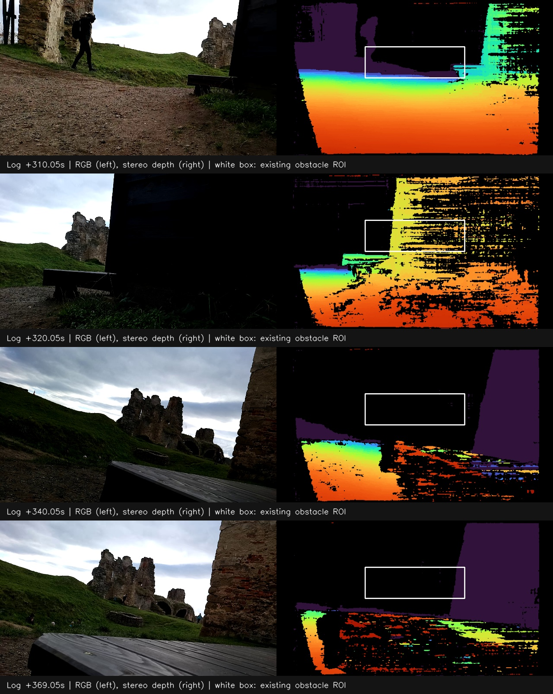
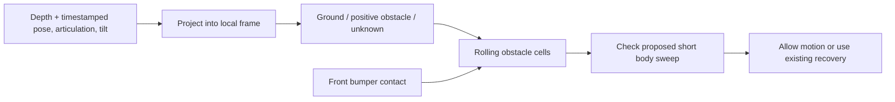

# DH2 MVP: local obstacle memory

Design for the low wooden platform/step at the end of
`/data/matty/m04-dh2-261031_101546.log`. This is a proposed application feature,
not an enabled controller change or a validated collision-avoidance result.

Implementation starts with the [stage 1 indoor procedure](dh2-indoor-stage1.md):
camera IMU acquisition, factory calibration capture and offline sensor checks.
The pose provider and obstacle-map veto remain subsequent stages.

## What the recording shows

Baseline `app` replay matches, without `-F`. The first front-bumper activation is
at **369.009757 s**. There are **13 front-bumper activations** from then to the
end; these include repeated transitions during recovery, not necessarily 13
separate deliberate approaches. No rear-bumper activations occurred.

| Offset | Recorded behavior/evidence |
| --- | --- |
| ~310–320 s | The low wooden platform beside the booth is visible during the approach/scans. |
| ~340–368 s | The camera looks across/above the nearby platform. Short detector acquisitions interrupt scanning. |
| 368.737 s | Starts another exploration advance. |
| 369.010 s | First front-bumper activation; enters recovery scanning. |
| 374.261 s | A recovery departure is followed by contact at 374.871 s. |
| 388.323 s | Another departure is followed by contact at 388.940 s. |
| 403.781 s | Orienting for another recovery path; emergency stop at 403.794 s. |

Immediately before first contact, recorded `app.clearance` is **not blocked**:
its distance is about 15.037 m. That value belongs to the existing upper-middle
ROI, not the distance to the step. The ROI covers depth rows 30–50% and columns
30–70%. A low obstacle can be below it, and later below the depth image entirely.



RGB is on the left and left-camera-aligned depth on the right. White rectangles
show the existing depth ROI. The views are separate, not pixel-aligned. Depth
colors here cover 0.15–3 m; black means no valid measurement.

Recorded ESP32 roll is roughly −10 to −16 degrees through much of the late
approach, with changing articulation. A level-camera, flat-ground projection is
not sufficient to classify small steps in this sequence. The existing offline
`dh2.mapping` preview has neither roll compensation nor obstacle classification;
its all-time mean-height grid should not be used directly as a driving costmap.

## Smallest useful feature

Add a **rolling 2D obstacle map in the current run's odometry frame**. Classify
obstacles from each depth frame, then retain that evidence as the camera moves.
Keep only short-range geometry; no GPS, OSM, SLAM, loop closure or global coverage
planner is needed for this case.

The important behavior is: **looking over a previously observed step must not
make the step disappear from the motion check**. A scan direction with distant
visible surfaces is not automatically a traversable route for the robot body.



## Frames and a reusable Matty pose3d provider

Only the camera's transform **within the front section** is rigid. There is no
single rigid camera-to-whole-robot transform while the platform articulates.
Define a front-body frame `front` with a measured origin fixed in that section,
X forward, Y left, Z up. The depth optical frame has its own calibrated fixed
transform to `front`. Then:

`T_odom_depth(t) = T_odom_front(t) * T_front_depth`

The uncertain part belongs in a **Matty pose provider**, not inside the depth
mapper. It must identify what point/heading `platform.pose2d` actually integrates
and account for front-section translation as well as rotation during articulation.
A stationary center or zero commanded speed does not imply a stationary camera.
The existing `pose_yaw + joint/2` is a hypothesis to test, not a frame definition.

Propose a reusable `MattyPose3D` application node, outside the DH2 mission module
(e.g. a future `matty/pose3d.py` package). Inputs are wheel-derived odometry,
measured articulation and front-camera IMU; ESP32 attitude can be an explicitly
configured historical-data source. Publish OSGAR's existing **`pose3d`** format:

```text
[[x_metres, y_metres, z_metres], [qx, qy, qz, qw]]
```

The message describes `front` in a run-local `odom` frame; the origin, axis
conventions and extrinsics are configuration, recorded with the log. Initial
position can be zero and initial heading arbitrary, while vertical is gravity-
aligned. The mapper then accepts a conventional pose3d and fixed sensor transform,
without knowing how Matty's chassis articulates. The footprint query still needs
both body sections and their measured geometry.

Reuse OSGAR quaternion helpers and the conventions in `osgar.drivers.odoimuloc`.
That existing node rotates signed odometry increments by an orientation and
publishes pose3d; it does not establish Matty's front-frame kinematics or lever
arms, so it is not a drop-in estimator for this platform. Keep the Matty-specific
provider in osgar-apps initially, reusable by other applications here. Any later
move of proven generic functionality to OSGAR is separate work.

A quaternion does **not** supply translation or reliable elevation. Wheel travel
and tilt can provide a dead-reckoned Z estimate once the kinematics are established;
slip, passive articulation and unmeasured motions remain errors. Do not double-
integrate raw acceleration to manufacture an accurate Z. Publish a companion
quality/mode indication (e.g. `planar_esp32` versus `wheel_oak_imu`), distinguishing
assumed Z from estimated Z. Historical logs cannot acquire the missing camera
IMU measurements retroactively. Ground-relative obstacle classification remains
necessary even when a pose3d is available.

## Camera IMU and synchronization

Use **rectified left-camera depth intrinsics at 640×400** and measure camera/IMU
extrinsics plus both section footprints, including bumpers. Obtain m04 calibration
with the existing `rerun-route/get_oak_calibration.py` workflow. Neither RGB
intrinsics nor another robot's calibration is a substitute.

For future recordings, enable the OAK-D Pro IMU's integrated orientation **and**
raw accelerometer/gyro. The available OSGAR DepthAI v3 driver exposes:

- `oak.orientation_list`: batches of `[device_seconds, accuracy, qx, qy, qz, qw]`;
- `oak.acc_raw_list`: batches of `[device_seconds, ax, ay, az]`;
- `oak.gyro_raw_list`: batches of `[device_seconds, gx, gy, gz]`.

Proposed future camera configuration fragment (not enabled in the contest config
by this design update):

```json
{
  "is_imu_enabled": true,
  "imu_orientation": true,
  "imu_raw_data": true,
  "disable_magnetometer_fusion": true,
  "number_imu_records": 5
}
```

Use the integrated orientation first, with verified mounting/axis transforms and
initial alignment to local odometry. Record raw samples for diagnosis, bias checks
and later estimator development; do not fuse them a second time as independent
measurements of the same attitude. Avoid relying on magnetic heading beside the
castle masonry. Batch size 5 is a starting latency/overhead tradeoff, to measure.

IMU data was disabled during the contest. The `101546` investigation therefore
uses only recorded ESP32 attitude, with its sign/mounting/frame conventions
verified separately. The core Matty driver's rotation conversion itself carries
a review note. This is an explicit dataset mode, not runtime sensor fallback.

Use each IMU sample's acquisition time, not the arrival time of its whole batch.
Check clock domains: the inspected driver uses `getTimestampDevice()` for IMU
samples and `getTimestamp()` for depth sequence metadata; do not assume their
numbers share an epoch. Establish the device/DepthAI/host time mapping and its
uncertainty before combining `depth_seq` with IMU batches. Old-log analysis can
retain the documented approximate host-time association.

Buffer depth until bracketing pose/attitude samples arrive when needed. Interpolate
XYZ and measured joint angles, and interpolate quaternions with shortest-path
SLERP (including q versus -q equivalence). Reject excessive gaps/extrapolation;
0.3 s remains the initial maximum gap. Account for processing latency in the
motion margin. Do not use current attitude for an older captured depth frame.

## Depth classification

Process the useful full depth image, including its lower half. Exclude calibrated
self returns and invalid/zero depth, not an entire band containing low steps.
Start with a 0.2–3 m range, every fourth pixel, at 5 Hz.

For each frame:

1. Back-project valid pixels using the depth intrinsics and transform them using
   the camera extrinsics, measured articulation and body tilt.
2. Fit a robust local support plane to nearby ground returns. Constrain the fit
   by gravity, the expected ground below the chassis, and a configurable allowed
   slope. Do not blindly call the largest visible plane “ground”: the platform
   top or booth wall could otherwise become the reference plane.
3. Mark connected positive-obstacle patches: a riser/height discontinuity, or
   a surface standing above the supported ground. A provisional **8 cm rise**
   threshold is an experimental starting point, not Matty's proven climb limit.
   Keep ordinary ramps distinct from abrupt height changes.
4. Require supporting pixels and at least two distinct depth frames before a
   depth-only obstacle is confirmed. A bumper contact is immediately confirmed.
   Record which frame supplied each observation so many pixels from one frame
   cannot masquerade as repeated evidence.
5. If no credible ground reference exists, classify low-step evidence as unknown.
   Preserve existing obstacles. Do not turn zero depth into free ground.

The first offline task is to verify that the step's face/top discontinuity is
actually measurable before contact. An approximate 90-degree HFOV projection
was inspected during this review, but m04 intrinsics and extrinsics are missing;
its heights are not sufficient to claim an 8 cm classification result.

## Map representation and retention

Suggested initial size: **6×6 m**, **5 cm cells** (120×120 = 14,400 cells).
The grid is **odometry-aligned, not robot-heading-aligned**. Its axes stay fixed
for the run. Turning rotates the robot/camera footprint within the map; it does
not rotate or resample stored cells. A robot-up display may rotate a rendered
image without changing the stored representation.

As the robot translates, move the window origin by integer cell increments.
For example, use `floor(front_xy / resolution) - [60, 60]` as its lower-left global
cell index. Retained cells keep their original odometry coordinates; only cells
outside the new window are evicted. A fixed frame also avoids interpolation blur
from repeatedly rotating a small obstacle during stationary look-around.

Store per cell:

- confirmed obstacle flag and evidence source (depth or bumper);
- distinct-frame support, recent ground-relative height range;
- first/last observation time and observing pose.

Bound the data by the rolling window. Store summaries, not an unbounded history
of point clouds. Initial positive-only obstacle memory is enough here; defer
ray-traced free-space clearing and probabilistic occupancy updates.

**Do not clear an obstacle because:**

- its old pixels become zero or leave the camera's field of view;
- the camera is now looking above it, or a new ray passes above its height;
- the robot stops long enough for a short wall-clock TTL to expire;
- it lies near/under the robot's footprint: automatically stamping that area
  “free” would erase the step in exactly this case.

Evict cells when they leave the local window. For the first version, obstacles
near the robot persist while stationary. A later version can remove dynamic
obstacles using repeated, height-aware contradictory observations. Simple time
expiry would be easy but would reintroduce this failure after a long scan.

Unknown remains distinct from free. For this MVP, unknown alone does not inhibit
motion, preserving the existing open-space/zero-depth behavior. Consequently
this feature is **not a drop-off detector or proof of safe support ahead**.

## Motion check and recovery

Check the proposed **next 0.5 m movement**, not just the depth along the current
camera axis. Sample its path about every 2 cm using Matty's existing constant-
articulation kinematics. Cover both articulated sections and bumpers. The simplest
conservative first implementation uses a measured circumscribed footprint around
the correct pose reference; a two-section footprint can reduce false blocking
later. Add an initial 10 cm uncertainty margin, then validate it against pose,
calibration, timing and stopping error. Use the measured dimensions, not invented
width/length defaults.

- A confirmed cell intersecting the proposed sweep vetoes forward motion,
  regardless of whether today's central depth ROI is clear.
- Check on every depth/pose update while moving, and immediately before issuing
  a positive-speed command. Retain the existing immediate depth stop, emergency
  stop and directional bumper checks.
- Reuse recovery's left/center/right candidates. Query their short sweeps against
  the same map. Look-around at speed zero can gather new observations, but cannot
  clear remembered cells merely by looking away.
- On front contact, stop immediately and add a short blocked strip along the
  **measured front bumper**, with a few centimeters of outward thickness and the
  localization margin. Press/release transitions do not clear it. This prevents
  recovery from repeatedly selecting the same contact location even if the step
  was never measured by stereo.
- If all forward candidates are blocked, use the already-authorized bounded
  reverse (up to 30 cm, rear bumper stops it) and rescan. The map does not establish
  rear clearance. Keep existing reverse limits; do not restart repeated reversing
  just because the same front contact bounces.
- If contact already overlaps the estimated footprint, forward re-entry remains
  forbidden. Preserve the existing bounded retreat as the escape action rather
  than requiring an initially collision-free forward sweep from that pose.

This is a short-horizon motion veto and candidate selector, not a new full path
planner. It avoids blindly retrying the remembered step; it does not promise that
an escape route exists or that Matty can climb this particular platform.

## Node boundaries and periodic map snapshots

Keep a reusable Matty pose provider separate from the obstacle map and DH2 mission:

```text
wheel odometry + articulation + camera IMU -> MattyPose3D -> pose3d
pose3d + depth + bumpers                  -> LocalObstacleMap
map + candidate body sweeps               -> DH2 motion/recovery decision
```

A proposed `LocalObstacleMap` can expose `observe_depth(...)`,
`mark_front_contact(...)`, `advance_pose(...)`, and `check_sweep(...)`. Only
incoming OSGAR messages receive `on_*` names. Share projection/interpolation
helpers with `dh2.mapping` where conventions agree; do not silently change the
existing preview's geometry. Footprint/contact transforms use the same Matty
frame conventions as the pose provider.

**Publish complete map snapshots every X seconds**, configurable on the map node:

```json
{
  "size_m": 6.0,
  "resolution": 0.05,
  "publish_period": 1.0
}
```

This cadence is independent of the proposed 5 Hz map-update rate. Keep updating
and checking motion between publications; the controller must not wait for a
one-second diagnostic snapshot to stop. If mapping is a separate node, publish
motion-veto/clearance results on every relevant update rather than consuming only
the periodic map. Select the interval for review volume and required time detail.

Publish from OSGAR timer/input timestamps, **not wall time, a thread's sleep, or
CPU load**. Start the cadence from a defined input timestamp; publish on the first
recorded tick at/after each deadline, without inventing backdated snapshots if
several deadlines are crossed. Tie-breaking, ground-plane sampling/seed and cell
ordering must also be deterministic.

Each snapshot must be independently interpretable, rather than just a picture
or a list of changes. Proposed versioned `local_map` message fields:

| Field | Meaning |
| --- | --- |
| `version`, `sequence` | Schema version and monotonically increasing publication ID |
| `frame_id` | Run-local `odom`; no implicit geographic heading |
| `data_time_us`, `publish_time_us` | Latest represented input and publication-trigger log times |
| `resolution`, `shape` | Metres/cell and `[rows_y, columns_x]` |
| `origin` | Pose3d of the lower-left cell **corner**, odometry axes, identity grid rotation |
| `front_pose3d`, `joint_angle`, `pose_mode` | Platform state and quality/mode used for interpretation |
| `cell_state`, `source_bits` | Full row-major byte arrays; row index increases along +odom Y |
| `last_seen_us` | Full array of observation timestamps; explicit integer encoding and unknown sentinel |
| `input_sequence`, `geometry_id` | Source depth sequence and calibration/config identifier |

Keep unknown, observed support and confirmed obstacle distinct. Ground-relative
height summaries, support counts and candidate/veto details can be optional
versioned layers. The grid origin's Z=0 is a display/reference plane, **not a
claim that the terrain is level**.

Use OSGAR serialization and optional stream compression (`local_map:gz`). The
current serializer handles a top-level NumPy array but not arbitrary arrays nested
inside a dict: encode layers as bytes with declared dtype/shape (e.g. uint8 state,
little-endian int64 timestamps), or use separate array streams. Do not invent
an incompatible nested-array payload.

Initially run **in shadow mode**: record pose/map/veto proposals without changing
steering. Add a bird's-eye viewer panel that can read recorded snapshots directly,
next to RGB/depth. Independently rerun mapping on the same inputs and compare
snapshot contents and timing using ordinary OSGAR replay. Same data/config should
produce the same map payloads; compare decoded payloads rather than file bytes or
PNG hashes. Record computed poses as well so pose and map reproducibility can be
checked separately.

A later opt-in controller setting enables the veto. Use the single shared DH2
config with prefix-specific calibration lookup as needed. New IMU acquisition and
estimation settings must be explicit and recorded; the contest configuration and
lockfile are not changed by this proposal update. No additional mission-duration
or general sensor watchdog is needed.

## Concrete acceptance checks

1. **Blind near-field memory:** a synthetic low step is seen in two frames, then
   disappears below the image. Its cell still blocks the same forward sweep.
   Zero/invalid depth, stationary scanning and a pause longer than a proposed TTL
   must not remove it.
2. **Geometry:** fixed obstacles stay fixed during a stationary ±30-degree scan,
   including camera translation as the front articulates. Test q/-q and yaw wrap,
   tilted/cross-slope scenes, and both articulated footprints. A pure robot rotation
   must not rotate/re-index the stored grid; a one-cell window translation must
   retain overlapping cells exactly.
3. **Recorded case:** plot +300 to +403.8 s, including the observation time/position
   of step evidence, current versus remembered points, proposed sweeps, and all
   bumper transitions. Show whether confirmed depth evidence blocks the
   +368.737 s advance *before* +369.010 s contact. If it does not, report why;
   persistence alone cannot recover a step that depth never observed.
4. **Contact fallback:** after +369.010 s the inferred bumper strip must veto
   repeated forward re-entry into that patch, including the recorded departures
   at +374.261 and +388.323 s where their sweeps intersect it. Validate direction
   changes against actual swept geometry, not just the sign of steering.
5. **Negative controls:** the traversed bridge/entry in this run and successful
   cone approaches (`104205`, `105430`, `110047`) must not become globally blocked
   by remembered flat/sloped ground. Open-space zero depth still permits movement.
6. **Pose and map replay:** replay the same raw inputs twice and compare published
   pose3d, snapshot times/origins/cell payloads, and veto outputs. Vary publication
   period without changing map updates or decisions. Verify that a saved snapshot
   alone can be displayed at the correct odometry position, including after window
   shifts; test irregular input ticks and delayed IMU batches.
7. **Driving integration:** verify unchanged replay with shadow mode disabled.
   With veto enabled, inspect ordinary replay's first output difference, then
   force replay to inspect vetoes on recorded inputs. That does not validate the
   new physical trajectory; repeat the step approach on hardware at low speed.

The first acceptance target is this specific late-run step and its repeated
contacts. General terrain classification, cliff protection, dynamic clearing and
global route planning remain separate work.
