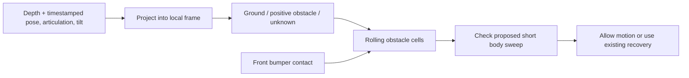

# DH2 MVP: local obstacle memory

Design for the low wooden platform/step at the end of
`/data/matty/m04-dh2-261031_101546.log`. This is a proposed application feature,
not an enabled controller change or a validated collision-avoidance result.

## What the recording shows

Baseline `app` replay matches, without `-F`. The first front-bumper activation is
at **369.009757 s**. There are **13 front-bumper activations** from then to the
end; these include repeated transitions during recovery, not necessarily 13
separate deliberate approaches. No rear-bumper activations occurred.

| Offset | Recorded behavior/evidence |
| --- | --- |
| ~310–320 s | The low wooden platform beside the booth is visible during the approach/scans. |
| ~340–368 s | The camera looks across/above the nearby platform. Short detector acquisitions interrupt scanning. |
| 368.737 s | Starts another exploration advance. |
| 369.010 s | First front-bumper activation; enters recovery scanning. |
| 374.261 s | A recovery departure is followed by contact at 374.871 s. |
| 388.323 s | Another departure is followed by contact at 388.940 s. |
| 403.781 s | Orienting for another recovery path; emergency stop at 403.794 s. |

Immediately before first contact, recorded `app.clearance` is **not blocked**:
its distance is about 15.037 m. That value belongs to the existing upper-middle
ROI, not the distance to the step. The ROI covers depth rows 30–50% and columns
30–70%. A low obstacle can be below it, and later below the depth image entirely.

RGB is on the left and left-camera-aligned depth on the right. White rectangles
show the existing depth ROI. The views are separate, not pixel-aligned. Depth
colors here cover 0.15–3 m; black means no valid measurement.

Recorded ESP32 roll is roughly −10 to −16 degrees through much of the late
approach, with changing articulation. A level-camera, flat-ground projection is
not sufficient to classify small steps in this sequence. The existing offline
`dh2.mapping` preview has neither roll compensation nor obstacle classification;
its all-time mean-height grid should not be used directly as a driving costmap.

## Smallest useful feature

Add a **rolling 2D obstacle map in the current run's odometry frame**. Classify
obstacles from each depth frame, then retain that evidence as the camera moves.
Keep only short-range geometry; no GPS, OSM, SLAM, loop closure or global coverage
planner is needed for this case.

The important behavior is: **looking over a previously observed step must not
make the step disappear from the motion check**. A scan direction with distant
visible surfaces is not automatically a traversable route for the robot body.

## Geometry and synchronization

- Use **rectified left-camera depth intrinsics at 640×400**. Read m04's actual
  calibration with the existing `rerun-route/get_oak_calibration.py` workflow.
  Neither RGB intrinsics nor another robot's calibration is a substitute.
- Measure the camera-to-platform transform and the footprint, including bumpers.
  Odometry pose origin must be identified. Apply camera translation as the front
  section articulates; yaw rotation alone misses that small translation.
- Use measured `platform.joint_angle`, not desired steering, including during
  stationary look-around. The existing `pose_yaw + joint/2` convention is a
  starting hypothesis requiring a stationary scan against a fixed wall.
- Use ESP32 roll/pitch to express points relative to gravity. Verify axis signs,
  mounting bias and whether its IMU frame is on the front or rear section. The
  core Matty driver itself marks its rotation convention for review. Do not use
  magnetometer yaw to replace local odometry yaw in this MVP.
- Buffer depth until the next odometry sample if needed, then interpolate pose,
  articulation and tilt at its host-log timestamp. Unwrap angles; reject gaps
  over 0.3 s or extrapolation, as the offline mapper already does. This is bounded
  processing latency, not support for devices joining late. Measure any constant
  depth-pipeline delay and include the resulting motion error in the margin.

A 2D pose has no reliable elevation. Therefore store **obstacle evidence in XY**,
not an assumed globally accurate ground height. Ground-relative height is
estimated afresh for each frame; it is used for classification, not averaged
across a hillside as though the robot's altitude were constant.

## Depth classification

Process the useful full depth image, including its lower half. Exclude calibrated
self returns and invalid/zero depth, not an entire band containing low steps.
Start with a 0.2–3 m range, every fourth pixel, at 5 Hz.

For each frame:

1. Back-project valid pixels using the depth intrinsics and transform them using
   the camera extrinsics, measured articulation and body tilt.
2. Fit a robust local support plane to nearby ground returns. Constrain the fit
   by gravity, the expected ground below the chassis, and a configurable allowed
   slope. Do not blindly call the largest visible plane “ground”: the platform
   top or booth wall could otherwise become the reference plane.
3. Mark connected positive-obstacle patches: a riser/height discontinuity, or
   a surface standing above the supported ground. A provisional **8 cm rise**
   threshold is an experimental starting point, not Matty's proven climb limit.
   Keep ordinary ramps distinct from abrupt height changes.
4. Require supporting pixels and at least two distinct depth frames before a
   depth-only obstacle is confirmed. A bumper contact is immediately confirmed.
   Record which frame supplied each observation so many pixels from one frame
   cannot masquerade as repeated evidence.
5. If no credible ground reference exists, classify low-step evidence as unknown.
   Preserve existing obstacles. Do not turn zero depth into free ground.

The first offline task is to verify that the step's face/top discontinuity is
actually measurable before contact. An approximate 90-degree HFOV projection
was inspected during this review, but m04 intrinsics and extrinsics are missing;
its heights are not sufficient to claim an 8 cm classification result.

## Map representation and retention

Suggested initial size: **6×6 m**, centered around the robot, **5 cm cells**
(14,400 cells). Keep coordinates fixed in odometry; move the window as the robot
moves. Store per cell:

- confirmed obstacle flag and evidence source (depth or bumper);
- distinct-frame support, recent ground-relative height range;
- first/last observation time and observing pose.

Bound the data by the rolling window. Store summaries, not an unbounded history
of point clouds. Initial positive-only obstacle memory is enough here; defer
ray-traced free-space clearing and probabilistic occupancy updates.

**Do not clear an obstacle because:**

- its old pixels become zero or leave the camera's field of view;
- the camera is now looking above it, or a new ray passes above its height;
- the robot stops long enough for a short wall-clock TTL to expire;
- it lies near/under the robot's footprint: automatically stamping that area
  “free” would erase the step in exactly this case.

Evict cells when they leave the local window. For the first version, obstacles
near the robot persist while stationary. A later version can remove dynamic
obstacles using repeated, height-aware contradictory observations. Simple time
expiry would be easy but would reintroduce this failure after a long scan.

Unknown remains distinct from free. For this MVP, unknown alone does not inhibit
motion, preserving the existing open-space/zero-depth behavior. Consequently
this feature is **not a drop-off detector or proof of safe support ahead**.

## Motion check and recovery

Check the proposed **next 0.5 m movement**, not just the depth along the current
camera axis. Sample its path about every 2 cm using Matty's existing constant-
articulation kinematics. Cover both articulated sections and bumpers. The simplest
conservative first implementation uses a measured circumscribed footprint around
the correct pose reference; a two-section footprint can reduce false blocking
later. Add an initial 10 cm uncertainty margin, then validate it against pose,
calibration, timing and stopping error. Use the measured dimensions, not invented
width/length defaults.

- A confirmed cell intersecting the proposed sweep vetoes forward motion,
  regardless of whether today's central depth ROI is clear.
- Check on every depth/pose update while moving, and immediately before issuing
  a positive-speed command. Retain the existing immediate depth stop, emergency
  stop and directional bumper checks.
- Reuse recovery's left/center/right candidates. Query their short sweeps against
  the same map. Look-around at speed zero can gather new observations, but cannot
  clear remembered cells merely by looking away.
- On front contact, stop immediately and add a short blocked strip along the
  **measured front bumper**, with a few centimeters of outward thickness and the
  localization margin. Press/release transitions do not clear it. This prevents
  recovery from repeatedly selecting the same contact location even if the step
  was never measured by stereo.
- If all forward candidates are blocked, use the already-authorized bounded
  reverse (up to 30 cm, rear bumper stops it) and rescan. The map does not establish
  rear clearance. Keep existing reverse limits; do not restart repeated reversing
  just because the same front contact bounces.
- If contact already overlaps the estimated footprint, forward re-entry remains
  forbidden. Preserve the existing bounded retreat as the escape action rather
  than requiring an initially collision-free forward sweep from that pose.

This is a short-horizon motion veto and candidate selector, not a new full path
planner. It avoids blindly retrying the remembered step; it does not promise that
an escape route exists or that Matty can climb this particular platform.

## Application structure

Keep the runtime utility in `dh2/`, separate from OSGAR core. A proposed
`LocalObstacleMap` can expose `observe_depth(...)`, `mark_front_contact(...)`,
`advance_pose(...)`, and `check_sweep(...)`. Only incoming OSGAR messages receive
`on_*` names. Share projection/interpolation helpers with `dh2.mapping` where
conventions agree; do not silently change the existing preview's geometry.

Initially run it **in shadow mode**: record map obstacles and proposed vetoes,
with no connection to steering. Suggested debug output includes cell resolution,
odometry origin, confirmed cells and evidence age, candidate sweeps, and a veto
reason/nearest blocking cell. Add a bird's-eye panel to the viewer so RGB, depth,
remembered cells and proposed motion can be inspected at the same log offset.

A later opt-in controller setting enables its veto. New required runtime links
are `platform.joint_angle` and verified tilt, in addition to existing pose/depth.
Use the single shared DH2 config and prefix-specific calibration lookup if robot
geometry differs. Do not enable metric obstacle classification with guessed
intrinsics. No additional mission-duration or general sensor watchdog is needed.

## Concrete acceptance checks

1. **Blind near-field memory:** a synthetic low step is seen in two frames, then
   disappears below the image. Its cell still blocks the same forward sweep.
   Zero/invalid depth, stationary scanning and a pause longer than a proposed TTL
   must not remove it.
2. **Geometry:** fixed obstacles stay fixed during a stationary ±30-degree scan;
   translation, angle wrap and downhill/cross-slope scenes do not create a false
   riser. Test actual body footprint and articulated sweep intersections.
3. **Recorded case:** plot +300 to +403.8 s, including the observation time/position
   of step evidence, current versus remembered points, proposed sweeps, and all
   bumper transitions. Show whether confirmed depth evidence blocks the
   +368.737 s advance *before* +369.010 s contact. If it does not, report why;
   persistence alone cannot recover a step that depth never observed.
4. **Contact fallback:** after +369.010 s the inferred bumper strip must veto
   repeated forward re-entry into that patch, including the recorded departures
   at +374.261 and +388.323 s where their sweeps intersect it. Validate direction
   changes against actual swept geometry, not just the sign of steering.
5. **Negative controls:** the traversed bridge/entry in this run and successful
   cone approaches (`104205`, `105430`, `110047`) must not become globally blocked
   by remembered flat/sloped ground. Open-space zero depth still permits movement.
6. **Driving integration:** verify unchanged replay with shadow mode disabled.
   With veto enabled, inspect ordinary replay's first output difference, then
   force replay to inspect vetoes on recorded inputs. That does not validate the
   new physical trajectory; repeat the step approach on hardware at low speed.

The first acceptance target is this specific late-run step and its repeated
contacts. General terrain classification, cliff protection, dynamic clearing and
global route planning remain separate work.
