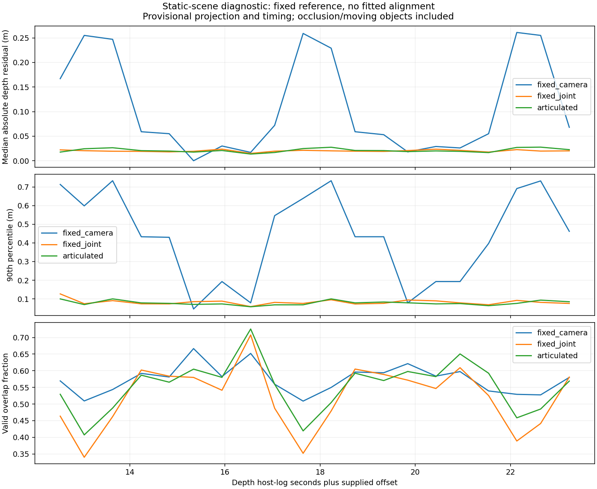

# Stage 2: depth consistency across camera motion

Offline check, 2026-11-03. `dh2.scene_check` compares recorded depth frames using
the passive pose provider. It does not fit ICP corrections, adjust calibration,
or change the provider/controller. The results support using front attitude in
projection, but do not establish map accuracy or complete stage 2.

## Reproduce

First generate the pose log using [the pose replay procedure](dh2-pose-stage2.md).
Then, from the repository root:

```bash
uv run --locked python -m dh2.scene_check \
  /data/matty/m04-dh2-261102_174346.log \
  --pose-log /tmp/dh2-pose-stage2/m04-dh2-261102_174346/pose.log \
  --intrinsics 400.13818 400.20917 324.24768 195.83195 \
  --optical-offset 0.21 0.0375 0.16 \
  --start 12 --output /tmp/dh2-scene-check/settled/174346
```

Outputs are `pairs.csv`, `report.json` and `residuals.png`. Start/end times select
native depth host-log times. `--depth-time-offset` shifts only the time queried
in the pose log; it does not move the sampling window. Pose interpolation uses
the recorded acquisition time in `pose_quality`, not delayed publication time.
Unknown-translation intervals and missing pose brackets are excluded.

The intrinsics are the captured **resized physical-left camera** values, not
verified rectified-depth intrinsics. The left optical centre is provisionally
placed 37.5 mm left of the centred housing reference, using half the 75 mm stereo
baseline. Its forward/vertical location and nominal optical rotation remain
assumptions. These parameters are explicit inputs, not a new robot calibration.
Driver source sets depth alignment to CAM_B (left), with RGB alignment disabled
in the DH2 configuration. Factory left rectification participates in the pose
provider's attitude conversion; the scene tool uses its nominal optical/body axes.

## Measurement

Choose the first eligible depth frame as a fixed reference. For each later frame,
project reference depth into its view and project the later depth back into the
reference. Compare predicted versus observed optical Z at the nearest pixel.
Report median and 90th-percentile absolute residual, matched point count and
overlap fraction for three models:

- `fixed_camera`: camera pose remains at the reference.
- `fixed_joint`: front attitude changes and rotates the optical lever arm, but
  joint position stays at the reference.
- `articulated`: both joint position and front attitude follow the provider.

Sampling uses every fourth pixel, depths 0.3–3 m and a four-neighbour smoothness
mask with an 80 mm edge limit. Missing depths are excluded. There is no residual
clipping: large disagreements remain in the statistics. Correspondence sets and
overlap differ between models, so the numbers are comparative diagnostics, not
measurements on identical independent points. Symmetric signed medians should
not be interpreted as depth bias estimates.

## Existing-log results

All six runs are M04 on 2026-11-02. Image inspection showed startup exposure
changes and sparse depth in the earliest frames. The table uses `--start 12`
for every run, chosen from that visual observation rather than a residual fit.

| Run | Setup | Frame pairs | Fixed camera median / P90 (mm) | Fixed joint median / P90 (mm) | Articulated median / P90 (mm) |
| --- | --- | ---: | ---: | ---: | ---: |
| `174346` | Flat | 20 | 62 / 508 | 20 / 81 | 20 / 79 |
| `174419` | Front right raised | 26 | 83 / 749 | 23 / 132 | 14 / 80 |
| `174456` | Both front wheels raised | 29 | 66 / 789 | 16 / 87 | 13 / 69 |
| `174534` | Rear right raised | 26 | 169 / 432 | 22 / 63 | 22 / 58 |
| `175816` | First box approach | 42 | 312 / 1536 | 326 / 880 | 57 / 455 |
| `175940` | Second box approach | 44 | 263 / 1192 | 306 / 1017 | 108 / 579 |



Front-attitude compensation provides most of the improvement in stationary
scans. Joint translation improves the tilted-run results and the translating
box cases, but does not clearly improve the flat-run median. This is insufficient
to validate the estimated lateral displacement in `174456` independently.
The box runs still have substantial tail disagreement; static-scene registration
is not solved simply because the median improves.

## Sensitivity, not calibration fitting

Flat `174346`, same native frame selection with `--start 12 --end 23`, 19 pairs:

| Deliberate assumption change | Articulated median / P90 (mm) |
| --- | ---: |
| Nominal offset, zero depth time shift | 20 / 78 |
| Depth queried 100 ms earlier | 19 / 77 |
| Depth queried 100 ms later | 28 / 190 |
| Optical centre on housing centreline | 22 / 83 |
| Optical centre 75 mm left of housing | 19 / 78 |

These are alternative assumptions, not fitted corrections or confidence bounds.
No best-scoring offset is installed. The timing test shows why exact acquisition
clock mapping matters during articulation. The lateral sweep shows that a few
millimetres of median improvement cannot settle the mechanical optical offset.

## Remaining work

Occlusions, lighting-dependent depth, nearest-pixel association, changing views
and any moving objects all contribute to residuals. Inspected samples show
furniture, floor and doorway surfaces; they have not been manually segmented
into certified static patches. Pooled pixel statistics are correlated, and a
plane cannot constrain every component of camera motion.

Next isolate persistent floor/wall/box patches in settled frames, verify the
rectified projection and camera/depth timing, and compare against independently
measured motion. Set an acceptance budget from those independent uncertainties
before enabling map decisions. Joint Z remains assumed, not observed. All
reports have `usable_for_driving=false` and no acceptance threshold.

The [follow-up selected-patch analysis](dh2-static-patches.md) now separates
planarity from alignment on 25 observations. It finds useful near-ground
consistency and coarse distant-depth plateaus; calibrated translation accuracy
and clock mapping remain unverified.

Validation: five synthetic tests cover known translation/rotation against planes,
incorrect-pose residuals, depth holes/edges, unclipped large residuals, pose timing
and optical lever arms. These are software checks, separate from the six recorded
data experiments. [Machine-readable run settings and results](dh2-scene-check.json).
