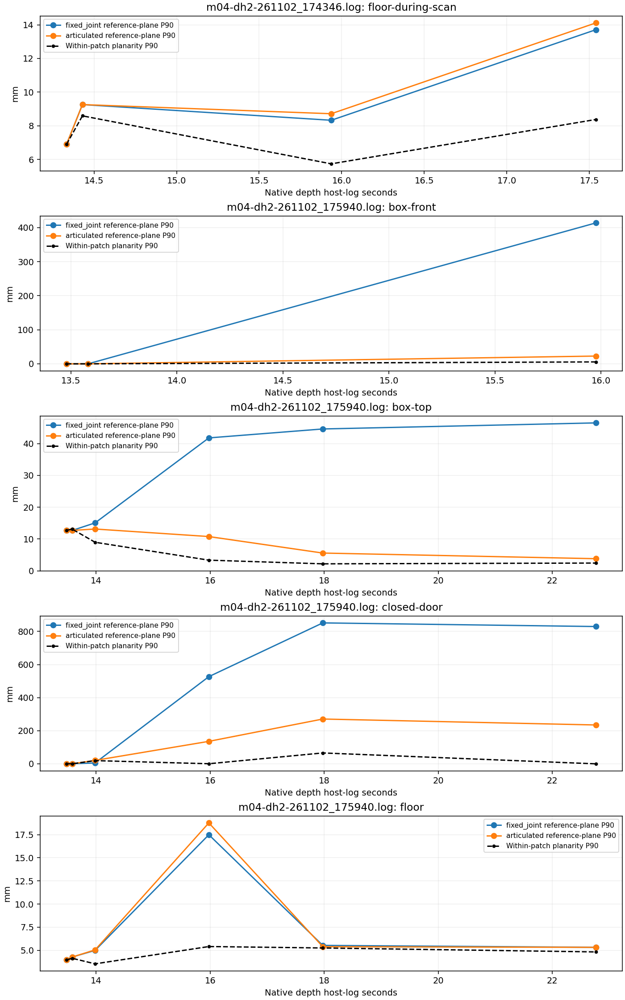

# Stage 2: selected static depth patches

Offline analysis, 2026-11-03. The new `dh2.patch_check` separates local surface
planarity from cross-frame alignment. Twenty-five manually selected observations
cover the floor during stationary steering in `174346`, and the floor, closed
wooden door, box top and box front during the approach in `175940`.

The near surfaces are encouraging: floor reference-plane P90 residuals stay below
19 mm, and the box front is within 23 mm after about 0.39 m estimated forward
travel. The distant door still disagrees by up to 271 mm. These measurements do
not establish full translation accuracy or complete stage 2.

## Reproduce and inspect

Generate both pose logs using [the pose replay procedure](dh2-pose-stage2.md), then:

```bash
uv run --locked python -m dh2.patch_check \
  --annotations dh2/config/static-patches-261102.json \
  --pose-dir /tmp/dh2-pose-stage2 \
  --output /tmp/dh2-patch-check/nominal
```

`--logs-dir` defaults to `/data/matty`. Outputs include `patches.csv`,
`report.json`, `errors.png` and an annotated depth-image sheet for each recording.
Repeat with `--depth-time-offset=-0.1` or `--depth-time-offset=0.1` to inspect
timing sensitivity on exactly the same annotated depth frames. No fitted
correction changes the pose or controller.

[ROI annotations](../dh2/config/static-patches-261102.json) use half-open depth
pixel rectangles and requested host-log timestamps. The nearest recorded frame
must be within 60 ms; actual timestamps and valid point fractions are reported.
Labels were selected from depth and nearby RGB views, with local plane normals
used to check surface identity. RGB/depth pixels are not assumed aligned.

The box front disappears below the image earlier than the top. A candidate lower
ROI at +17.98 s had a near-horizontal normal: it was viewing the top, not the
front face. It is not included in the front-face sequence. At +15.98 s the front
ROI is below the top/front boundary, at rows 365–385; an earlier candidate at
340–355 crossed that boundary. These are semantic ROI corrections, not pose fits.

## What is measured

For each observation, retain valid 0.3–3 m depths with the existing four-neighbour
80 mm edge mask. Fit an untrimmed least-squares plane and report perpendicular
point-to-plane residuals. No residual threshold removes poorly fitting points.

The first observation of each named patch defines its reference plane in the
estimated world frame. Later points are transformed using either a fixed joint
position with changing front attitude, or the articulated estimate. Report their
distance to that reference plane, plus normal changes, centroids and depth-value
concentration. Fitting each local plane is diagnostic; it never corrects a pose.

Intrinsics, optical offset, clock mapping and joint Z retain the assumptions in
the [previous scene check](dh2-scene-check.md). A floor or box-top plane cannot
validate translation parallel to its surface. A reference-plane tilt also couples
horizontal displacement into the residual; improved top-plane alignment is not
independent proof of correct horizontal odometry.

## Results

Values below are the **largest per-observation P90** in each sequence, not pooled
pixel percentiles or statistical confidence bounds. Each sequence includes its
reference observation. Two nearly repeated observations around +13.48/+13.58 s
in the box run provide a quiet comparison before the first advance.

| Run and surface | Observations | Local planarity P90, max (mm) | Articulated reference-plane P90, max (mm) |
| --- | ---: | ---: | ---: |
| `174346`, floor during scan | 4 | 8.6 | 14.1 |
| `175940`, floor | 6 | 5.4 | 18.8 |
| `175940`, box top | 6 | 13.1 | 13.1 |
| `175940`, box front | 3 | 5.6 | 22.8 |
| `175940`, closed door | 6 | 65.8 | 270.7 |



The stationary floor sequence covers approximately +17° and −16° front yaw.
Its fitted world normal changes by at most about 1.8° relative to the reference.
The smallest visible floor ROI has only 497 valid points of 1600, so neither
that normal nor its residual should be treated as a precise calibration.

At +15.98 s, the near box front has a 22.8 mm reference-plane P90 residual after
about 0.39 m estimated joint travel. The fixed-joint model is wrong by about
0.41 m there, demonstrating that translation is necessary. The door at that same
time has a 135.9 mm residual. This range-dependent disagreement does not justify
a global encoder-scale adjustment from these observations.

The box-top centroid is **100–117 mm above the same-frame local floor plane**,
consistent with the operator's approximately 100 mm box. This is a relative
height check, using the floor plane extrapolated to the top centroid, not an
independent camera-height or optical-extrinsic calibration. The top observations
continue to +22.77 s; no claim is made for the later interval when the obstacle
leaves the useful depth view entirely.

## Quantization can look like precision

The door reference patch has 5262 of 5267 valid points at exactly **2.506 m**.
Its plane-fit P90 is only 0.7 mm. At +22.77 s, every valid point in the door ROI
is at **1.671 m**, giving effectively zero local plane residual despite a
234.8 mm mismatch to the original world plane.

These logs use stereo without subpixel disparity. For nominal focal length
400 pixels and baseline 75 mm, the local scale of a one-pixel disparity step is
approximately `Z² / (fx * baseline)`: **209 mm at 2.506 m**, versus roughly
10–34 mm over the selected box-top ranges. This is a scale illustration, not an
uncertainty bound, proof of the exact rounding convention, or an explanation of
every door error. Correspondence bias and geometry/odometry error remain possible.
It does explain why millimetre local planarity is not millimetre range accuracy.

## Timing sensitivity

Largest articulated reference-plane P90 over the same frames (mm):

| Depth queried at | Scan floor | Approach floor | Box top | Box front | Door |
| --- | ---: | ---: | ---: | ---: | ---: |
| Host −100 ms | 13.5 | 19.2 | 12.9 | 41.6 | 271.1 |
| Host | 14.1 | 18.8 | 13.1 | 22.8 | 270.7 |
| Host +100 ms | 14.4 | 18.2 | 13.4 | 9.9 | 269.9 |

The translating near face is sensitive to timing; floors and the far-door
disagreement do not identify the same offset. Combined with the previous whole
scene results, this is insufficient to install a new clock correction.

## Consequence for the next step

Keep the current pose and calibration settings. The selected near-ground evidence
is useful for a future obstacle-memory regression, but horizontal position and
uncertainty still need independent validation. Next verify rectified-depth
intrinsics and acquisition clock mapping, then use a measured forward/reverse
trial to check translation. A stationary comparison with subpixel stereo enabled
would help assess range quantization before changing mapping thresholds; it is
not enabled by this analysis.

Seven synthetic tests cover plane degeneracy/outliers, misleading constant-depth
precision, known translation, unobservable parallel translation, invalid depth
and exact annotation/frame selection. All 80 DH2/Matty tests and focused lint pass;
the existing flat pose replay still matches. These are software and recorded-data
checks, not new hardware validation. All reports remain unusable for driving.

[Machine-readable nominal results and timing summary](dh2-patch-check.json).
